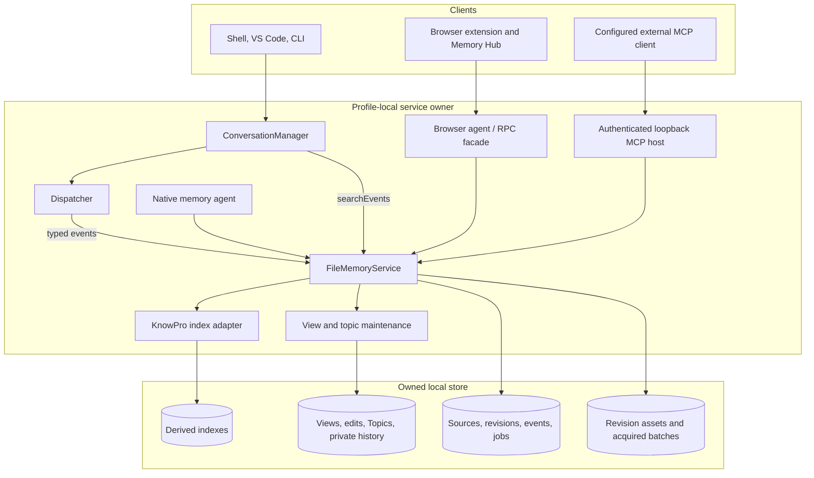

# TypeAgent memory: current system

**Audience:** maintainers, agent authors and engineers debugging integration.
**Source review:** October 16, 2026, TypeAgent `00748a4be`.
This is a code/test-contract map, not a new live acceptance run.

Start with [Memory architecture](memory.md) for concepts,
[Derived Views](derived-views.md) for artifact lifecycle, and
[Scenarios](scenarios.md) for user journeys.

## Design rules

1. KnowPro owns content retrieval: structured matching, related terms and
   configured embedding support. No independent lexical/vector engine is added.
2. Ingestion uses one model-driven `content` pipeline. There are no import presets.
3. Retain sources, exact revisions, events, suppression/forget state and explicit
   human intent. Indexes are derived; editable View history is not disposable.
4. Producers acquire content/provenance; the service owns indexing, retrieval,
   answers, derived construction and lifecycle.

## Runtime topology

The agent server constructs one service under `<instanceDir>/memory`, starts
the loopback host, and injects service facades into consumers. Native commands
do not need an HTTP/MCP round trip. The runtime `memory-mcp` agent uses that
same service with host-managed credentials. This does not establish automatic
endpoint/token discovery for arbitrary external clients.

Prepared document searches and knowledge reads can overlap within per-corpus
read reservations. Mutations and index preparation are exclusive; queued writers
block later readers, and active readers retain their snapshot. This is not
multi-process shared ownership. Model calls for View construction run outside
the serialized commit boundary and are rechecked before materialization.

Sources: [host construction](https://github.com/microsoft/TypeAgent/blob/main/ts/packages/agentServer/server/src/durableMemoryService.ts),
[server wiring](https://github.com/microsoft/TypeAgent/blob/main/ts/packages/agentServer/server/src/server.ts),
[service](https://github.com/microsoft/TypeAgent/blob/main/ts/packages/memory/service/src/fileMemoryService.ts).
Coverage: [read concurrency](https://github.com/microsoft/TypeAgent/blob/main/ts/packages/memory/service/test/readConcurrency.spec.ts).

## Conversation memory

With a durable service, the dispatcher writes typed events to
`typeagent-profile-conversations`; there is no separate per-conversation
content store or unified content index in that path.

| Event                    | Authority                                         |
| ------------------------ | ------------------------------------------------- |
| `user-turn`              | `user-assertion`                                  |
| `assistant-evidence`     | `evidence-only`                                   |
| `verified-action-result` | `verified-observation`, including failure outcome |
| `explicit-decision`      | `explicit`                                        |
| `task-outcome`           | `evidence-only`                                   |

`@conversation search` groups KnowPro-ranked events by conversation.
Historical `index` backfills user turns from display logs. Deleting a conversation
purges its events and records a tombstone. Authority labels distinguish evidence
classes; they do not certify every stored assertion.

No-service hosts retain the legacy conversation path and explicitly fail
unsupported durable-content operations. The Copilot memory plugin intentionally
uses a separate workspace-scoped `ConversationMemory`; do not describe it as
another facade over this profile store.

Sources: [durable conversation adapter](https://github.com/microsoft/TypeAgent/blob/main/ts/packages/dispatcher/dispatcher/src/context/conversationDurableMemory.ts),
[initialization](https://github.com/microsoft/TypeAgent/blob/main/ts/packages/dispatcher/dispatcher/src/context/memory.ts),
[conversation manager](https://github.com/microsoft/TypeAgent/blob/main/ts/packages/agentServer/server/src/conversationManager.ts).
Coverage: [conversation integration](https://github.com/microsoft/TypeAgent/blob/main/ts/packages/dispatcher/dispatcher/test/conversationMemoryIntegration.spec.ts).

## Durable corpus memory

The service owns corpora, source revisions, jobs, events, search/answers,
source synopses, revision assets, acquired batches, Changes receipts and
derived Views. It does not own saved-procedure CRUD or promotion.

Source types include web, Markdown, text, HTML and VTT. Acquisition adapters
normalize other input formats before ingestion; a diagram's PDF label is not
a separate `SourceType` or a claim about every importer.

Missing/older derived-index schema descriptors trigger scoped reset/rebuild.
Malformed or newer descriptors fail explicitly. Inspect the current
[schema contract](https://github.com/microsoft/TypeAgent/blob/main/ts/packages/memory/service/src/indexSchema.ts)
rather than copying a schema version into integration code.

## Producers and consumers

| Surface               | Actual role                                                                          | Boundary                                                                 |
| --------------------- | ------------------------------------------------------------------------------------ | ------------------------------------------------------------------------ |
| Native `@memory`      | Corpora, secure local Markdown import, search/ask, source/job management and Changes | Host reads paths; not a command for every View method                    |
| Dispatcher/reasoning  | Typed conversation events; conversation and saved-document recall                    | No saved-procedure or derived-View branch is implied                     |
| Browser/Memory Hub    | Capture/import, evidence browsing, Views, maintenance, Topics and editorial controls | Requests route to the owning service; browser is not a second store      |
| RPC/in-process client | Typed source, View and maintenance operations                                        | Head/version guards and capability checks remain authoritative           |
| MCP                   | Content ingestion, management, Views, Topics and maintenance tools                   | Authenticated host transport; standalone owner configuration is separate |

Sources: [native agent](https://github.com/microsoft/TypeAgent/blob/main/ts/packages/agents/memory/README.md),
[reasoning search](https://github.com/microsoft/TypeAgent/blob/main/ts/packages/dispatcher/dispatcher/src/context/personalMemorySearch.ts),
[View tools](https://github.com/microsoft/TypeAgent/blob/main/ts/packages/memory/mcp-server/src/viewTools.ts),
[client](https://github.com/microsoft/TypeAgent/blob/main/ts/packages/memory/client/src/memoryClient.ts).

## Source and event lifecycle

Ingestion retains exact revision identity and a durable job. Replacement uses
expected revisions; source forgetting requires preview/confirmation. Authorized
removal is durably enrolled before cleanup, with corpus content reads withheld
until source/index/View/history/assets/batch/context cleanup completes.
Late model work cannot reintroduce removed evidence. Restart/reconciliation
resumes incomplete removal.

Events retain producer/idempotency, authority, time and optional source/
conversation/run/turn provenance. Event forgetting writes tombstones and purges
dependent Views, including event-backed timelines, without requiring deletion of
an independently retained linked source.

See [History and forgetting](derived-views.md#history-and-forgetting).
Coverage: [source acquisition](https://github.com/microsoft/TypeAgent/blob/main/ts/packages/memory/service/test/sourceAcquisition.spec.ts),
[maintenance foundation](https://github.com/microsoft/TypeAgent/blob/main/ts/packages/memory/service/test/maintenanceFoundation.spec.ts).

## Search and answer semantics

| Surface                         | Evidence/result                                                             |
| ------------------------------- | --------------------------------------------------------------------------- |
| `@conversation search`          | Events ranked then grouped into conversation results                        |
| Reasoning `search_memory`       | Conversation recall and non-conversation corpus source searches in parallel |
| Durable `search`                | Source-linked evidence, optional source/tag/capture-date constraints        |
| Durable `answer` / native `ask` | Synthesized answer by default; extractive request returns evidence snippets |
| `searchViews`                   | Current eligible, exact published **and** indexed derived revisions         |
| `queryTopics`                   | Maintained navigation nodes with original evidence and explicit limits      |

When informational support is enabled, non-extractive `answer` retrieves bounded
indexed fragments and calls `answerIndexedEvidence`, then rechecks exact citation
eligibility before delivery. Otherwise the configured corpus-index answer path
uses KnowPro answer support. Synthesis failure is an error, not a silent
extractive success. Test adapters without answer support are not product fallback
implementations.

`dateFrom`/`dateTo` on source search filter active capture dates before the result
limit. Unknown capture dates do not become indexing dates. Do not infer claim
validity time, event time or identical filters on every answer API.

Synopses are revision-bound generated previews with status and fidelity limits,
not independent evidence. Derived Views are not corroborating sources. Hub
source/derived search does not establish the same routing in reasoning tools.

Sources: [service types](https://github.com/microsoft/TypeAgent/blob/main/ts/packages/memory/service/src/types.ts),
[indexed locators](https://github.com/microsoft/TypeAgent/blob/main/ts/packages/memory/service/src/indexedFragments.ts),
[answer dispatch](https://github.com/microsoft/TypeAgent/blob/main/ts/packages/memory/service/src/fileMemoryService.ts).

## Views, defaults and maintenance

Views and informational Wiki/Projects are default-on. Host options can disable
Views or informational work independently; invalid environment settings fail.
Configured provider constraints are separate from rehearsal budgets.

Indexed families discover/refresh after indexing, defer automatic work while a
durable bulk import is active, and reconcile on startup and a 30-second sweep.
This interval repairs dirty hints; it is not a completion SLA. Pause/resume,
no-op, retry/parking and explicit timeline/troubleshooting maintenance are
described in [View maintenance](view-maintenance.md).

Sources: [options](https://github.com/microsoft/TypeAgent/blob/main/ts/packages/memory/service/src/viewHostOptions.ts),
[capability parsing](https://github.com/microsoft/TypeAgent/blob/main/ts/packages/memory/service/src/viewBuildValidation.ts).
Coverage: [host options](https://github.com/microsoft/TypeAgent/blob/main/ts/packages/memory/service/test/viewHostOptions.spec.ts),
[batch maintenance](https://github.com/microsoft/TypeAgent/blob/main/ts/packages/memory/service/test/batchMaintenance.spec.ts).

## Storage and ownership

The service-owned store includes source manifests/revisions, event ledgers,
ingestion jobs and derived index generations. Revision-owned assets and acquired
batch state are independent from Views.

Each corpus's `views` directory contains a private bare `view-history.git`.
Committed snapshots hold typed Views, generated bases, edits, conflicts,
publication/maintenance state and Topics. `refs/heads/typeagent-history` is the
commit boundary. Per-revision derived search indexes remain separate.
The conversation registry/replay metadata is not a competing content store.

See [View history](derived-views.md#history-and-forgetting) and the
[service operational guide](https://github.com/microsoft/TypeAgent/blob/main/ts/packages/memory/service/README.md).

## Degraded behavior and failure modes

- Retained events can be appended without searchable projections; extraction/
  query/synthesis need configured models. There is no model-free content search.
- Source indexing and View generation are separate outcomes. A failed View must
  not be reported as a failed source import or fabricated document.
- Per-target View failures preserve completed peers; interrupted work is durable.
- Native session import state and service-owned acquired batches are different
  mechanisms. Closing an agent does not cancel already accepted service jobs.
- Failed privacy cleanup withholds reads; editor protection cannot override it.
- Store owner locks exclude another independent process from opening that store.

## Legacy and separate packages

The website-memory package is limited to acquisition/extraction helpers, not its
removed collection/graph/indexing service. Image memory and lightweight email
indexes are separate library consumers, not additional durable-service backends.
Keep legacy/no-service and workspace-plugin behavior explicitly scoped.

## Verification map

Source-reviewed contracts have focused service, RPC/MCP, dispatcher and browser
coverage. The [implementation ledger](https://github.com/microsoft/TypeAgent/blob/main/ts/docs/plans/memory-system/STATUS.md)
links the relevant tests and separates them from live quality, restart/UI and
performance acceptance. This documentation update ran no live memory workload.
