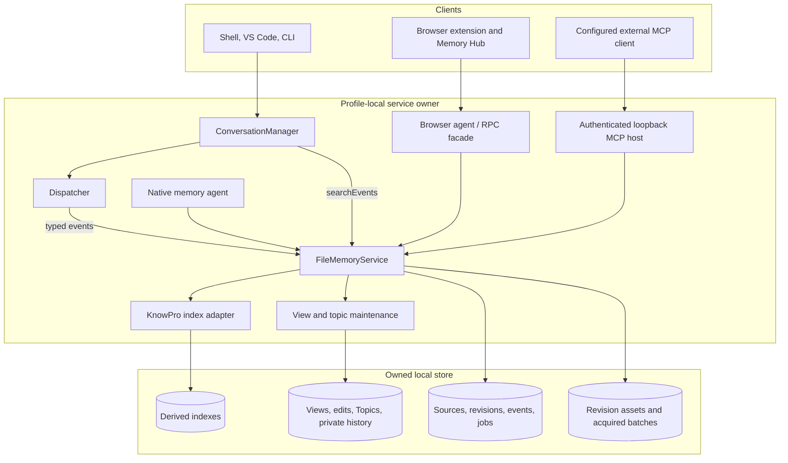

# TypeAgent memory: current system

For maintainers, agent authors and engineers debugging an integration.
Implementation references were checked on October 16, 2026 at TypeAgent
`00748a4be`. Live acceptance results are tracked in the
[implementation ledger](https://github.com/microsoft/TypeAgent/blob/main/ts/docs/plans/memory-system/STATUS.md).

Read [Memory architecture](memory.md) first for the concepts, then
[Derived Views](derived-views.md) for how documents are built and
[Scenarios](scenarios.md) for user journeys.

## Service responsibilities

1. KnowPro handles all content retrieval: structured matching, related terms and
   embeddings. There is no separate lexical or vector engine.
2. Ingestion uses one model-driven `content` pipeline. There are no import presets.
3. The service retains source revisions, events, suppression and forget state,
   and human edits. Indexes can be rebuilt; View edit history must be preserved.
4. Producers supply content and provenance. The service indexes that content,
   answers queries, builds derived documents and manages their lifecycle.

## Runtime topology

The agent server creates one service under `<instanceDir>/memory`, starts the
loopback host, and passes service facades to the consumers. Native commands call
the service directly, without an HTTP or MCP round trip. The runtime `memory-mcp`
agent uses the same service with credentials the host manages. External clients
need a configured endpoint and token.

Within one corpus, document searches and knowledge reads can run at the same time.
Writes and index preparation run alone. A queued writer blocks readers that
arrive later, and readers already running keep their snapshot. The store has a
single owner process. Model calls for View construction run outside the serialized
commit step, and the service rechecks their results before saving.

Sources: [host construction](https://github.com/microsoft/TypeAgent/blob/main/ts/packages/agentServer/server/src/durableMemoryService.ts),
[server wiring](https://github.com/microsoft/TypeAgent/blob/main/ts/packages/agentServer/server/src/server.ts),
[service](https://github.com/microsoft/TypeAgent/blob/main/ts/packages/memory/service/src/fileMemoryService.ts).
Coverage: [read concurrency](https://github.com/microsoft/TypeAgent/blob/main/ts/packages/memory/service/test/readConcurrency.spec.ts).

## Conversation memory

With a durable service, the dispatcher writes typed events to
`typeagent-profile-conversations`. That path has no separate per-conversation
content store or unified content index.

| Event                    | Authority                                         |
| ------------------------ | ------------------------------------------------- |
| `user-turn`              | `user-assertion`                                  |
| `assistant-evidence`     | `evidence-only`                                   |
| `verified-action-result` | `verified-observation`, including failure outcome |
| `explicit-decision`      | `explicit`                                        |
| `task-outcome`           | `evidence-only`                                   |

`@conversation search` ranks events with KnowPro and groups them by conversation.
`index` backfills user turns from display logs. Deleting a conversation purges
its events and records a tombstone. The authority labels separate classes of
evidence. They don't certify that every stored assertion is true.

Hosts without the service keep the legacy conversation path, and operations that
need durable content fail with a clear error. The Copilot memory plugin uses its
own workspace-scoped `ConversationMemory`. It is not a facade over the profile store.

Sources: [durable conversation adapter](https://github.com/microsoft/TypeAgent/blob/main/ts/packages/dispatcher/dispatcher/src/context/conversationDurableMemory.ts),
[initialization](https://github.com/microsoft/TypeAgent/blob/main/ts/packages/dispatcher/dispatcher/src/context/memory.ts),
[conversation manager](https://github.com/microsoft/TypeAgent/blob/main/ts/packages/agentServer/server/src/conversationManager.ts).
Coverage: [conversation integration](https://github.com/microsoft/TypeAgent/blob/main/ts/packages/dispatcher/dispatcher/test/conversationMemoryIntegration.spec.ts).

## Durable corpus memory

The service owns corpora, source revisions, jobs, events, search and answers,
source synopses, revision assets, acquired batches, Changes receipts and derived
Views. It has no saved-procedure CRUD or promotion.

Source types include web, Markdown, text, HTML and VTT. Acquisition adapters
convert other formats before ingestion. PDF support depends on the importer;
PDF is not a separate `SourceType`.

If a derived-index schema descriptor is missing or older, the service resets and
rebuilds that scope. If it is malformed or newer, the service fails with an error.
Read the current [schema contract](https://github.com/microsoft/TypeAgent/blob/main/ts/packages/memory/service/src/indexSchema.ts)
instead of copying a schema version into integration code.

## Producers and consumers

| Surface               | Role                                                                                      | Limit                                                                     |
| --------------------- | ----------------------------------------------------------------------------------------- | ------------------------------------------------------------------------- |
| Native `@memory`      | Corpora, secure local Markdown import, search and ask, source and job management, Changes | The host reads paths. Not every View method has a command                 |
| Dispatcher/reasoning  | Typed conversation events, conversation and saved-document recall                         | No saved-procedure or derived-View search                                 |
| Browser/Memory Hub    | Capture and import, evidence browsing, Views, maintenance, Topics, editing controls       | Requests go to the owning service. The browser has no store of its own    |
| RPC/in-process client | Typed source, View and maintenance operations                                             | Head and version guards and capability checks still apply                 |
| MCP                   | Content ingestion, management, Views, Topics and maintenance tools                        | Authenticated host transport. A standalone owner is configured separately |

Sources: [native agent](https://github.com/microsoft/TypeAgent/blob/main/ts/packages/agents/memory/README.md),
[reasoning search](https://github.com/microsoft/TypeAgent/blob/main/ts/packages/dispatcher/dispatcher/src/context/personalMemorySearch.ts),
[View tools](https://github.com/microsoft/TypeAgent/blob/main/ts/packages/memory/mcp-server/src/viewTools.ts),
[client](https://github.com/microsoft/TypeAgent/blob/main/ts/packages/memory/client/src/memoryClient.ts).

## Source and event lifecycle

Ingestion keeps the exact revision identity and creates a durable job. Replacing
a source uses expected revisions, and forgetting a source needs a preview and a
confirmation. Once removal is authorized, it is recorded durably before cleanup
starts. The service withholds corpus content reads until the source, index, View,
history, assets, batch and context data are cleaned up. A late model response
can't bring removed evidence back, and an interrupted removal resumes after a restart.

Events keep their producer and idempotency key, authority, time, and optional
source, conversation, run and turn provenance. Forgetting an event writes a
tombstone and purges dependent Views, including event-backed timelines. It
doesn't require deleting a linked source that is retained on its own.

See [History and forgetting](derived-views.md#history-and-forgetting).
Coverage: [source acquisition](https://github.com/microsoft/TypeAgent/blob/main/ts/packages/memory/service/test/sourceAcquisition.spec.ts),
[maintenance foundation](https://github.com/microsoft/TypeAgent/blob/main/ts/packages/memory/service/test/maintenanceFoundation.spec.ts).

## Search and answer semantics

| Surface                         | Result                                                                          |
| ------------------------------- | ------------------------------------------------------------------------------- |
| `@conversation search`          | Events ranked, then grouped into conversation results                           |
| Reasoning `search_memory`       | Conversation recall and corpus source searches, run in parallel                 |
| Durable `search`                | Source-linked evidence, with optional source, tag and capture-date filters      |
| Durable `answer` / native `ask` | A synthesized answer by default, or evidence snippets if you ask for extractive |
| `searchViews`                   | Current derived revisions that are eligible, published and indexed              |
| `queryTopics`                   | Maintained navigation nodes with original evidence and explicit limits          |

When informational support is on, a non-extractive `answer` retrieves a bounded
set of indexed fragments and calls `answerIndexedEvidence`. It then rechecks that
each citation is still eligible before it returns. Otherwise the configured
corpus-index answer path uses KnowPro answer support. If synthesis fails, the call
returns an error. Request extractive results explicitly if you want snippets
without synthesis.

`dateFrom` and `dateTo` on source search filter by capture date before the result
limit applies. A source with an unknown capture date doesn't get its indexing date
instead. These filters say nothing about when a claim was true or when an event
happened, and not every answer API accepts the same filters.

Synopses are generated previews tied to one revision. They carry a status and
fidelity limits, and they aren't independent evidence. Derived Views don't count
as corroborating sources either. Hub search over sources and derived content
doesn't mean reasoning tools route the same way.

Sources: [service types](https://github.com/microsoft/TypeAgent/blob/main/ts/packages/memory/service/src/types.ts),
[indexed locators](https://github.com/microsoft/TypeAgent/blob/main/ts/packages/memory/service/src/indexedFragments.ts),
[answer dispatch](https://github.com/microsoft/TypeAgent/blob/main/ts/packages/memory/service/src/fileMemoryService.ts).

## Views, defaults and maintenance

Views and the informational Wiki and Projects families are on by default. Host
options can turn off Views, or just informational work, and an invalid
environment setting causes an error. Provider constraints and rehearsal budgets
are separate settings.

Indexed families look for subjects and refresh after indexing. They hold off
automatic work while a durable bulk import is running, and they reconcile at
startup and in a sweep every 30 seconds. The sweep repairs missed dirty hints.
It is not a deadline for finishing work. [View maintenance](view-maintenance.md)
covers pause and resume, no-op results, retry and parking, and explicit
timeline and troubleshooting maintenance.

Sources: [options](https://github.com/microsoft/TypeAgent/blob/main/ts/packages/memory/service/src/viewHostOptions.ts),
[capability parsing](https://github.com/microsoft/TypeAgent/blob/main/ts/packages/memory/service/src/viewBuildValidation.ts).
Coverage: [host options](https://github.com/microsoft/TypeAgent/blob/main/ts/packages/memory/service/test/viewHostOptions.spec.ts),
[batch maintenance](https://github.com/microsoft/TypeAgent/blob/main/ts/packages/memory/service/test/batchMaintenance.spec.ts).

## Storage and ownership

The service-owned store holds source manifests and revisions, event ledgers,
ingestion jobs and derived index generations. Revision assets and acquired-batch
state are stored separately from Views.

Each corpus's `views` directory contains a private bare repository,
`view-history.git`. Its committed snapshots hold typed Views, generated bases,
edits, conflicts, publication and maintenance state, and Topics. The ref
`refs/heads/typeagent-history` marks the commit boundary. Per-revision derived
search indexes are kept apart from it, and the conversation registry and replay
metadata are not a second content store.

See [View history](derived-views.md#history-and-forgetting) and the
[service operational guide](https://github.com/microsoft/TypeAgent/blob/main/ts/packages/memory/service/README.md).

## Failure modes

- The service can append events even when the searchable projections aren't built.
  Extraction, query interpretation and synthesis need configured models, and
  there is no search that works without a model.
- Source indexing and View generation succeed or fail independently. A failed View
  must not be reported as a failed import, and the service must not invent a document.
- If one View target fails, the targets that finished stay saved. Interrupted
  work is durable.
- The native agent's session import state and the service's acquired batches are
  different mechanisms. Closing the agent doesn't cancel jobs the service has accepted.
- If privacy cleanup fails, reads stay withheld, and edit protection can't override that.
- Store owner locks stop a second process from opening the same store.

## Legacy and separate packages

The website-memory package now only contains acquisition and extraction helpers.
Its collection, graph and indexing service has been removed. Image memory and the
lightweight email indexes are separate library consumers, not backends of the
durable service. Keep legacy (no-service) behavior and the workspace plugin
clearly separate from this service when you write about them.

## Verification

Focused tests cover the service, RPC and MCP, dispatcher and browser contracts.
The [implementation ledger](https://github.com/microsoft/TypeAgent/blob/main/ts/docs/plans/memory-system/STATUS.md)
links the tests and tracks live model quality, restart behavior, UI acceptance
and performance separately.
