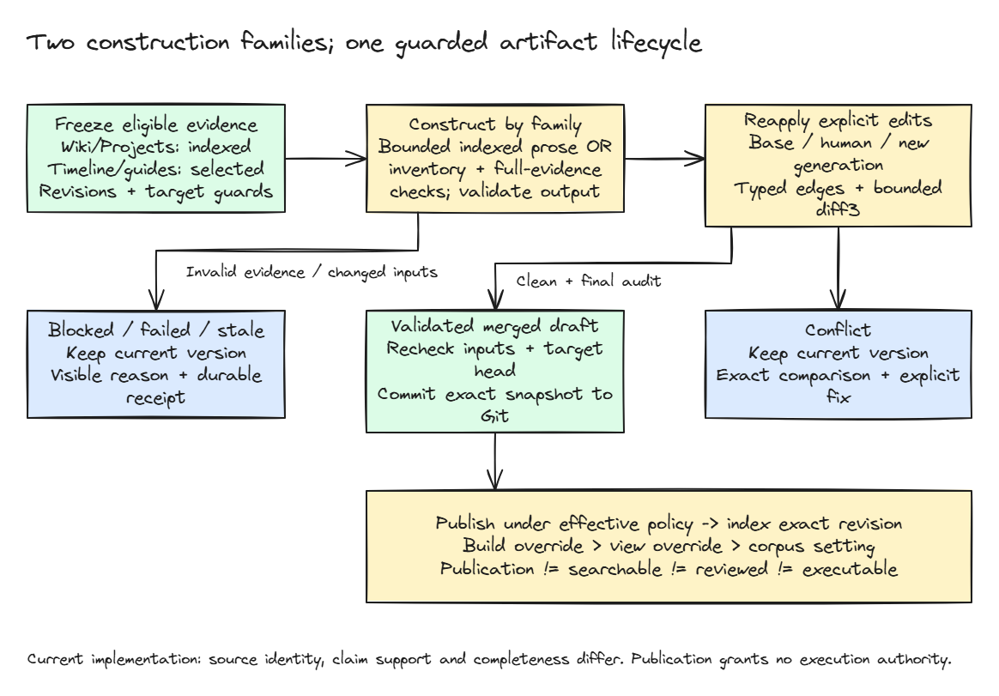
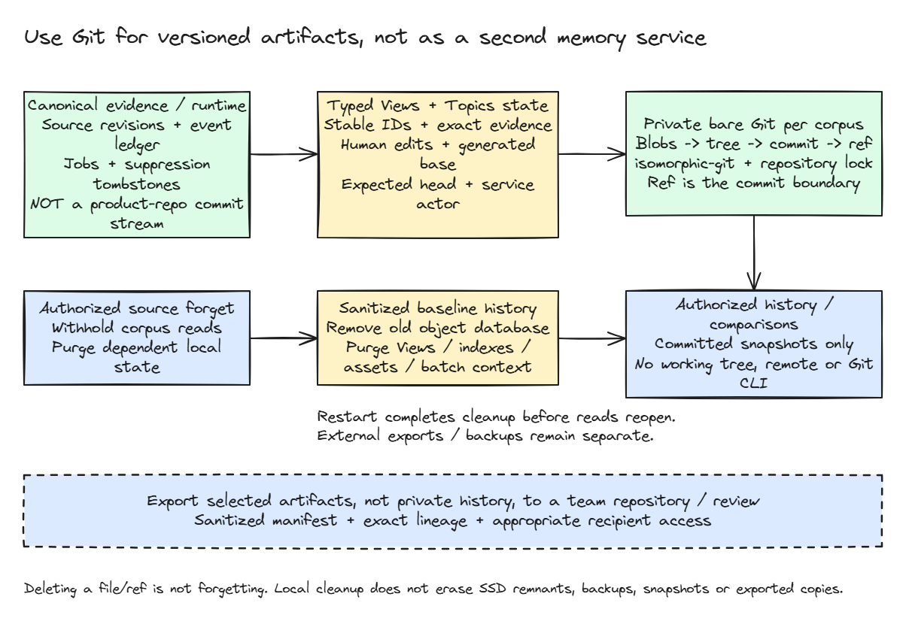

# Derived Views: construction, edits and publication

A View is an editable, versioned document derived from retained evidence.
It is neither a new source of truth nor an executable procedure. The same
service owns builds, generated bases, edits/conflicts, history, maintenance,
publication and derived search.

See [Memory architecture](memory.md) for the system model and
[View maintenance](view-maintenance.md) for refresh and discovery.

## Four kinds, two construction families

| Kind                  | Construction                              | Evidence and output                                                                                                                   |
| --------------------- | ----------------------------------------- | ------------------------------------------------------------------------------------------------------------------------------------- |
| Wiki                  | `informational-wiki-v1`                   | One independently identified page per record, bounded indexed citations, editorial category/note                                      |
| Project brief         | `informational-project-summary-v1`        | Bounded indexed evidence for a scoped initiative; goals, owners, separate status dimensions, milestones, decisions, risks and context |
| Timeline              | Full-evidence selected-record pipeline    | Exact source revisions and/or canonical events; distinct occurrence, learned, capture and generation times                            |
| Troubleshooting guide | Full-evidence inventory/checking pipeline | Selected retained evidence, prerequisites, diagnostic path, guards, verification and recovery limits                                  |

Wiki/Projects discover useful subjects across a collection and retrieve exact
indexed fragments; the user need not select every source. A single substantive
source can justify a page. Output is bounded, not an exhaustive collection
summary. Unknown ownership or project state must remain unknown.

Timeline/troubleshooting builders retain inventory, independent source checking,
construction and final coverage/support checks over their selected eligible
inputs. These model-based checks are not a semantic proof. Do not apply their
full-source inventory contract to informational Wiki/Projects.

Old inventory-backed Wiki bundles, `wiki-v1`, explicit-subject registries and
removed full-source project construction are not compatibility APIs.

## Build and materialization



[SVG](diagrams/view-build-flow.svg) · [Editable scene](diagrams/view-build-flow.excalidraw)

A build freezes the definition, evidence identities, configured model/recipe and
current target/head guards. Generation runs outside serialized writes. Before
saving, the service rechecks evidence eligibility, target/definition versions,
cancellation and privacy state. Concurrent edits or replaced/forgotten sources
cannot be overwritten by an old model result.

`buildViews` returns a durable job with per-target results. Job states include
`running`, `complete`, `partial`, `failed`, `cancelled` and `interrupted`.
Individual targets can be saved, merged, conflicted, blocked, stale or failed;
job completion alone does not say that every target produced a useful document.
Cancellation prevents future materialization without undoing already saved peers.

### Minimal API example

The following TypeScript runs in a host with an initialized View-capable service
named `views`. `corpusId` and `currentSources` must be real retained identities;
the array contains `{ sourceId, revisionId }` entries, not file paths.

```typescript
const { head } = await views.listViews(corpusId);
const job = await views.buildViews({
  corpusId,
  expectedHead: head,
  publication: false,
  targets: [
    {
      expectedVersion: 0,
      definition: {
        viewId: "incident-guide",
        kind: "troubleshootingGuide",
        selector: { kind: "sources", sources: currentSources },
      },
    },
  ],
});
const progress = await views.getViewBuild({ corpusId, jobId: job.jobId });
```

This creates a new guide target (`expectedVersion: 0`), not an overwrite request.
`progress` is a `ViewBuildJob | undefined`, not just a Boolean success. Handle a
missing receipt explicitly; otherwise inspect `state` and `results`. Do not
publish a requested ID before a saved exact revision exists.
For automatic Wiki/Projects, prefer the family operations in
[Maintenance](view-maintenance.md#service-and-ui-controls).

## Exact citations and relationships

Citations retain source/revision identity, locator and excerpt. Indexed
informational locators encode block identity/hash and bounded UTF-16 ranges;
full-evidence citations resolve retained original text. Timeline event citations
also identify the canonical event. Generation time is not event occurrence time.

Stable section IDs and typed relationships are not rendered graph labels.
Source-backed assertions and selector dependencies have different meanings.
Citation identity, claim support and relevant completeness need separate checks;
one cannot substitute for another. Generated Views must not be counted again
as independent evidence for the sources from which they were built.

## Explicit edits and conflicts

Human saves are authenticated by the service, with optimistic head/version guards.
Generated content retains its exact base separately from current human text.
Rebuilds merge **old generated base / current human / new generation**. Prose
uses bounded three-way merging; relationships retain semantic identities and
explicit removals. An LLM does not choose a merge winner.

For informational maintenance, deliberate human edit units are protected.
`protectedTargets` is authoritative service state; explicit unlock records user
intent before scheduling revision. Routine supported generated corrections can
remain automatic. Privacy removal overrides protection.

Overlaps preserve current content and create durable comparisons. Conflict
resolution requires exact current head/version/revision/input guards and an
explicit human/generated/combined choice. The resulting actual prose is checked;
a clean text merge is not semantic validation. See
[Editorial maintenance](view-maintenance.md#editorial-protection-and-consolidation).

## Publication and revision-matched search

Publication policy precedence is **one-build override > saved View override >
corpus policy**. Explicit `false` is not inheritance. Auto-publication defaults
on, but enabled behavior is not live-quality qualification.

For informational content, publication does not require the full-source
inventory proofs used by timeline/troubleshooting. Both paths still enforce
their own validation, current evidence, target guards and conflict/privacy gates.
Saving or reviewing an arbitrary unsourced draft does not manufacture a
validated generated base.

`getViewPublication` returns separate `latestBuiltRevisionId`,
`publishedRevisionId`, `indexedRevisionId`, `indexState` and reason fields.
`indexState` is `absent`, `pending`, `failed` or `ready`. A publication commit
can succeed while derivative indexing fails. `retryViewIndex` repairs the exact
published revision without generating another document.

`searchViews({ corpusId, query, freshness: "current" })` returns a
`ViewSearchMatch[]`. Each match includes the exact View, score/snippet,
original evidence, `review: "unreviewed"`, `freshness: "current"` and
`corroboration: "derived"`. Only eligible published revisions with matching ready
indexes are returned; pending drafts, stale evidence and unresolved conflicts
are not silently substituted into default retrieval.

## History and forgetting



[SVG](diagrams/view-history-boundary.svg) · [Editable scene](diagrams/view-history-boundary.excalidraw)

`listViews` returns the current corpus `head`; `getView` reads a current or exact
revision; `getViewHistory` returns `{ commitId, version }` entries. A View's
revision ID is not the corpus commit ID. Private Git commits snapshot artifact
state, not the KnowPro index or canonical source content.

Authorized source forgetting is durably enrolled. Source/index/View/history/
asset/batch/context cleanup must complete before corpus content reads reopen.
Dependent builds, conflict payloads, uncited influence and private history
cannot bypass forgetting through an older commit. Event forgetting also purges
dependent timelines. Restart resumes unfinished cleanup; deletion of a visible
file or ref alone is not this guarantee.

This is local managed removal, not secure erasure of SSD blocks, external
backups, screenshots or exported copies.

## Interfaces and verification

In-process/RPC, MCP and browser transports route to the owning service.
The native memory agent does not expose a command for every View operation.
The private-store CLI is another exclusive owner: never open a running server's
store with it.

Contracts: [View types](https://github.com/microsoft/TypeAgent/blob/main/ts/packages/memory/service/src/viewTypes.ts),
[store](https://github.com/microsoft/TypeAgent/blob/main/ts/packages/memory/service/src/viewStore.ts),
[MCP tools](https://github.com/microsoft/TypeAgent/blob/main/ts/packages/memory/mcp-server/src/viewTools.ts).
Focused coverage: [builds](https://github.com/microsoft/TypeAgent/blob/main/ts/packages/memory/service/test/viewBuilds.spec.ts),
[store](https://github.com/microsoft/TypeAgent/blob/main/ts/packages/memory/service/test/viewStore.spec.ts),
[Wiki cleanup](https://github.com/microsoft/TypeAgent/blob/main/ts/packages/memory/service/test/wikiCleanup.spec.ts).
Offline lifecycle checks are not live-model quality qualification.
