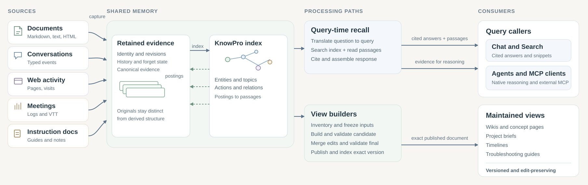

# Memory architecture

TypeAgent memory lets you search saved conversations and documents, ask questions
about them, and build documents that update when their sources change.

The memory service stores sources and events. KnowPro indexes their content for
search. Editable documents called Views collect selected evidence into wiki pages,
project briefs, timelines and troubleshooting guides. Each View keeps references
to its sources so you can check its claims.

For implementation details, see [Current system](current-system.md). For test
results and release readiness, see the
[evidence ledger](https://github.com/microsoft/TypeAgent/blob/main/ts/docs/plans/memory-system/STATUS.md).

## How the pieces fit

[Full-size SVG](diagrams/memory-overview.svg)

Sources feed both search and View generation. Instructional notes and guides are
stored as ordinary sources; skills and macros are managed separately outside the
memory service.

### What memory stores

| Representation                    | What it does                                                                                                         | Limit                                                                    |
| --------------------------------- | -------------------------------------------------------------------------------------------------------------------- | ------------------------------------------------------------------------ |
| Retained sources and typed events | Keeps identity, exact revisions, provenance, corrections, suppression and forgetting                                 | Storing a user's claim or guess doesn't make it true                     |
| KnowPro index                     | Holds extracted entities, topics, actions, relationships and postings, and runs retrieval                            | You can rebuild it from sources. It is not a graph database              |
| Editable Views                    | Wiki pages, project briefs, timelines and troubleshooting guides, with citations, generated bases, edits and history | Generated text is not independent evidence and can't authorize execution |
| Navigation projections            | Maintained Topics and per-revision source synopses                                                                   | Good for browsing. Cite the original source, not the synopsis            |

### Two processing paths

Recall happens at question time. TypeAgent interprets the question, retrieves
supporting passages, and returns snippets or a cited answer. Searching sources
works whether or not any View exists. The answer can itself be saved later as
conversation evidence, so recall isn't guaranteed to leave no trace.

View construction produces reusable, versioned documents. Wiki and Projects find
their own subjects and pull a bounded set of indexed fragments. Timeline and
troubleshooting builders check the full evidence of the sources you select. Both
kinds keep exact evidence identities, recheck eligibility before saving, and
either keep your edits or report a conflict. See [Derived Views](derived-views.md).

## Where to start

| If you are a...                           | Read                                                                                                                     |
| ----------------------------------------- | ------------------------------------------------------------------------------------------------------------------------ |
| Maintainer or integration author          | [Current system](current-system.md)                                                                                      |
| Working on View lifecycle or citations    | [Derived Views](derived-views.md)                                                                                        |
| Working on maintenance or editing         | [View maintenance](view-maintenance.md)                                                                                  |
| Product engineer, evaluator or demo owner | [Memory scenarios](scenarios.md)                                                                                         |
| Release planner                           | [Implementation evidence ledger](https://github.com/microsoft/TypeAgent/blob/main/ts/docs/plans/memory-system/STATUS.md) |
| Interested in Structured RAG              | [Structured RAG](#structured-rag), below                                                                                 |

## What works today

### Conversation recall

When a memory service is available, the conversation memory is the profile's
event ledger. The dispatcher records typed turns, evidence and outcomes, each
with an authority label. `@conversation find` locates conversations by name.
`search`, `summarize` and `index` use the conversation service, and `index`
imports user turns from older history.

The reasoning tool `search_memory` combines conversation recall with saved-document
search. It does not search saved procedures or derived Views. Two paths work
differently: hosts without the service use the legacy path, and the Copilot
memory plugin has its own workspace memory. Both are covered in
[Current system](current-system.md#conversation-memory).

### Managed document memory

The native `@memory` agent, browser clients and MCP all use the same service
contracts for corpora, sources, revisions, ingestion jobs, search, answers and
management. `@memory` validates local folder paths before it submits content.
MCP clients send content themselves because MCP can't read an arbitrary client
filesystem.

There is one model-driven `content` pipeline and no fast, balanced or deep
presets. `ask` writes an answer from retrieved evidence, and `ask --extractive`
returns snippets only. See [Search and answer semantics](current-system.md#search-and-answer-semantics).

### Browser and web activity

The browser saves normalized page content, and it records visits, bookmarks,
captures and imports as separate events. The Memory Hub shows sources, revisions,
knowledge, jobs, Views, Topics and editing controls. Capturing a source or its
assets is about evidence. It doesn't author procedures.

### Derived knowledge, not a procedure store

The service builds the four View kinds and handles their drafts, history,
maintenance, conflicts, publication and search. It no longer detects, stores,
retrieves or promotes saved procedures. Instruction-document and AgentEdition
helpers still exist for other consumers, but they don't add a procedure service.

## Defaults and maturity

Views and the informational Wiki and Projects families are on by default in
configured hosts. Set `TYPEAGENT_MEMORY_VIEW_DRAFTS=false` to turn off Views, or
`TYPEAGENT_MEMORY_INFORMATIONAL_VIEWS=false` to turn off informational maintenance.
If a provider is missing or a setting is invalid, the service reports an error
instead of returning a made-up result.

Four things are checked separately: source indexing, quality of generated
documents, UI acceptance and release readiness. Offline tests don't certify
arbitrary corpora. Check the dated [evidence ledger](https://github.com/microsoft/TypeAgent/blob/main/ts/docs/plans/memory-system/STATUS.md)
rather than assuming a default setting or an old trial means a feature is accepted.

## Storage and ownership

One local owner manages the profile store. Sources and events are the retained
evidence, and KnowPro indexes are derived from them. Editable View content,
generated bases, conflicts, maintenance records and Topics live in the per-corpus
View store, backed by a private Git history. They don't live in the product
repository or in a second source store.

Replacing, suppressing or forgetting a source limits what current reads can see
and blocks late model writes. When forgetting is authorized, the service removes
dependent local state and withholds reads until cleanup finishes. It can't erase
external exports, backups or leftover data on the disk. See
[History and forgetting](derived-views.md#history-and-forgetting).

## Known limits

- Extraction, question interpretation and answer synthesis can lose or misread context.
- A valid typed query doesn't prove the system understood what you meant. A citation
  that resolves doesn't prove the passage supports the generated claim.
- Wiki and Projects output is bounded and may not cover everything in a collection.
- "Published" and "ready for search" are separate states.
- Edit protection keeps your text from being overwritten but isn't an approval.
  Privacy removal overrides it.
- A Topic or graph link between two items doesn't make them the same project or entity.
- The local service doesn't provide remote sync, distributed ownership or enterprise governance.

## Structured RAG

KnowPro combines extracted structure with query interpretation at runtime:

1. Extract entities, actions, facets, topics and source ranges from content.
2. Index terms and semantic references that point back to the original passages.
3. Translate the natural-language question into a query that matches a schema.
4. Apply scopes, structured matching and ranking, plus related-term or embedding
   retrieval where configured.
5. Read the relevant evidence and return snippets or a cited answer.

Take "Who rejected scaling, and why?" The query can match on actor and action,
then read the original passage for the reason. The answer can still be wrong if
extraction missed the rejection, if translation picked only a general topic, or
if synthesis dropped the reason.

The structure makes the constraints easy to inspect. It doesn't prove better
accuracy, latency, cost or retention than vector retrieval. Related-term embeddings
take part in structured retrieval and not only as a last fallback. When you compare
approaches, use the same evidence, workload and questions.

## Code

- [KnowPro](https://github.com/microsoft/TypeAgent/tree/main/ts/packages/knowPro):
  extraction, indexes and search.
- [Memory service](https://github.com/microsoft/TypeAgent/tree/main/ts/packages/memory/service):
  durable evidence, management, derived Views and maintenance.
- [Memory MCP server](https://github.com/microsoft/TypeAgent/tree/main/ts/packages/memory/mcp-server):
  typed access for external clients.
- [Memory agent](https://github.com/microsoft/TypeAgent/tree/main/ts/packages/agents/memory):
  native commands and local import, using the injected service.
- [Conversation memory](https://github.com/microsoft/TypeAgent/tree/main/ts/packages/memory/conversation):
  a KnowPro-based library. Library users are not the same as the service-backed event ledger.

## Demos

The [one-minute Structured RAG demo](https://youtu.be/jTHOt4O7YuM) and the
[ninety-second agent-memory demo](https://youtu.be/CWgrAEK123U) are older
examples. They aren't current benchmarks or acceptance results.
