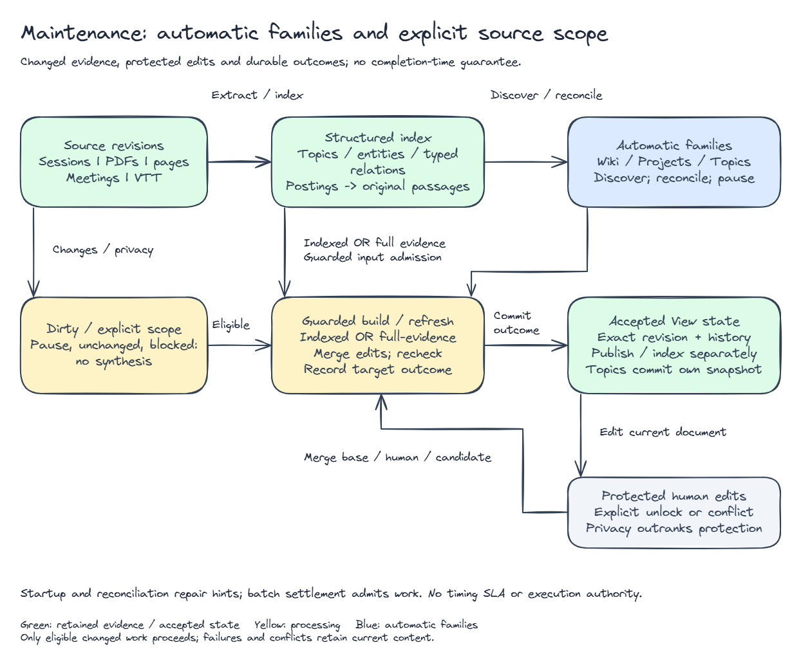

# Derived-view maintenance

When sources change, maintenance updates the Views that depend on them and
preserves your edits. Overlapping edits become conflicts you can review. See
[Derived Views](derived-views.md) for builds, citations, publication and history.

Views are on by default. A host can turn off all Views with
`TYPEAGENT_MEMORY_VIEW_DRAFTS=false`, or just the informational Wiki and Projects
with `TYPEAGENT_MEMORY_INFORMATIONAL_VIEWS=false`. Test rehearsal budgets limit
individual test runs, not product availability or lifetime usage. Provider request
throttling is configured separately from maintenance scheduling.

## Automatic and explicit work



[SVG](diagrams/view-maintenance.svg) · [Editable scene](diagrams/view-maintenance.excalidraw)

After indexing, automatic informational work finds and refreshes subjects. At
startup, and every 30 seconds afterward, a sweep finds work missed by change
notifications. This is a scheduling interval, not a synthesis deadline.

While a durable bulk import is running, automatic Topics and Wiki/Projects work
waits until the last active batch finishes. You can still start a build by hand.
Privacy invalidation never waits for the synthesis schedule.

Each target has a bounded amount of work and a deadline. Finished targets stay
committed. Technical failures, unchanged-content rejections and human conflicts
are recorded separately. A provider or materialization failure gets one automatic
retry and is then parked. Changed evidence or recipe, or an explicit rebuild,
reopens it. Cancelling is always explicit. Recovery finishes publication and
index steps that were already committed. It doesn't repeat synthesis or create
duplicate versions.

## Indexed Wiki and Projects

`informational-wiki-v1` is the only supported Wiki construction contract, and
`informational-project-summary-v1` is the project contract. Both use bounded
indexed fragments and exact citations, with no full-source inventory.

Family operations `update`, `rebuild`, `review`, `pause` and `resume` use the existing job
and View store. Pause is durable. Stable IDs don't depend on display titles. Saved
selectors, aliases, exclusions, category and notes keep the editor's intent.
`review` applies to Wiki and Projects, not Topics. It selects one accepted
article using the persisted review cursor and reassesses it without regenerating
its prose. It can explicitly retry a parked semantic assessment; it cannot
override archive, source exclusions or protected human edits. `rebuild` is not
a promise of semantic reassessment when the indexed input is unchanged.

A subject needs substantial local evidence to get a page; one source can be
enough. There is no page quota. A passing mention of a service is insufficient
to identify a project. Matching names or aliases prompt a comparison, but the
service keeps incompatible symbols, projects or episodes separate, or marks the
match as ambiguous.

Retrieval favors relevant indexed evidence, corrections and qualifications, and a
mix of sources. It doesn't promise to find everything. Wiki pages put retrieval
limits in their dedicated limits section, not repeated disclaimers in the summary
or explanatory prose. A substantive gap is relative to the article's purpose,
not an obligation to list every subject the sources don't cover. A native
`limits: null` explicitly reports no substantive gap; the saved `coverageNote`
is then empty and no coverage notice is rendered. A missing legacy coverage
assessment remains distinct from this explicit no-gap result.

A project page keeps owners, milestones, incident
closure, capacity qualification and overall project state apart. It distinguishes
a reviewer from a service owner and a rehearsal from a rollout.
Current consequential blockers belong early in the summary, and unresolved
blockers and required next work precede resolved or incidental history.
Ordering uses evidenced impact, severity, deadlines and dependencies without
inventing a formal severity or date. Topic salience and maintenance scheduling
priority are not issue urgency.

The service rejects old `wiki-v1` bundles, inventory-backed Wiki and Projects,
and explicit-subject registries instead of migrating them. Old qualification
receipts don't become current contracts.

### Source overlap, admission and contribution

When a new candidate shares sources or revisions with existing eligible pages,
the service compares their content and purpose. It records one of five outcomes:

- `distinct`: create a new independent page.
- `covered`: the existing prose already explains the key distinctions.
- `contribute`: refresh the page with the same scoped purpose using the missing evidence.
- `ambiguous`: record the possible destinations and their revisions; reconsider
  when that competing context changes, without automatically resolving human conflicts.
- `defer`: retain an evidence-scoped reason when a standalone explanation is not
  yet useful.

Ambiguity records the competing page identities and revisions. Changing or
archiving a competitor makes that ambiguity eligible for reassessment during
reconciliation, even if source evidence is unchanged. An unrelated publication
does not reopen an evidence-only deferral. Human conflicts and cancellation
remain separate from model ambiguity.

Shared citations alone don't show that the prose covers a topic. A contribution
uses bounded original indexed evidence, keeps earlier qualifications, validates
the merged prose and binds only once the exact canonical revision is ready. A
failure or conflict doesn't mark the candidate complete. Existing article text is
used only to compare and merge, and it never counts as a new source.

## Editorial protection and consolidation

The service protects identifiable units of human-edited content and lists them
in `protectedTargets`. Browser clients use that list. Unlocking a unit allows
maintenance to revise it; the service saves the unlock before scheduling work.
Saving an ordinary edit does not trigger synthesis.

Every initial informational build and update receives a factual check of the
actual merged output before saving: title, summary, structured fields, prose and
relationships. The check covers unsupported claims, quantities and cohorts,
scope, corrections and withdrawals, not just consequential edits.
Output without support is rejected as a technical failure and doesn't ask you for
blanket approval. If a human edit really overlaps, the existing recoverable
conflict path handles it.

The configured checker selects exact output locations and original fragment IDs,
with reasons and required corrections. The host binds the actual output values
and original quotes rather than asking the model to recopy them. One
complete-article repair is allowed for Wiki and
Projects, using the same evidence; human protection is remerged and the actual
result is checked again. A repeated rejection retains any previously accepted
revision. Custom informational adapters must provide an actual-output checker;
repair is optional and its absence does not turn a rejection into acceptance.

Project support is selected per section instead of attaching every article
source to every section. Structured statuses are coarse labels read with the
section's prose: a confirmed approval can still have an explicit condition, and
unavailable enum values must not become impossible repair requirements.

Generation is proportional to the evidence, not a token-length target. Required
unknowns stay brief and unsupported collections stay empty. In particular,
unknown ownership or absent approval does not establish a pending owner-review
process; `pendingOwnerReview` requires evidence of that process.

Contributing a new candidate is different from consolidating existing generated
articles. The service can consolidate generated articles that are unprotected,
have no human edits in their history, and are shown by current original indexed
evidence to have one scoped purpose, as long as the output checks pass. Shared
infrastructure, vocabulary, source lists or topic parents only suggest a comparison.

Consolidation keeps unique sections, excerpts and citations. It commits the
canonical article before it turns on a redirect, then waits until the exact
derived index is ready. Reading an old ID returns the canonical identity and
anchor mappings, and historical reads are still available when requested. After
a restart, committed effects resume without another synthesis. Pages that humans
have edited are never retired automatically. Redirect cycles, deep ancestry and
changed targets block the operation, so they can't produce a retry loop.
Consolidation does not establish that the entities mentioned in the articles
are identical, and it does not add a separate approval process.

### Completeness and periodic semantic review

Accepting an informational article also saves revision-bound review demand.
Article generation/publication, semantic assessment and consolidation application
have separate receipts and outcomes. A failed review does not turn an accepted
article into a failed build. Failure before a consolidation application receipt
exists remains retryable after restart without repeating article synthesis.
Prepared consolidation effects still recover through their existing staged
receipts; recovering them does not repeat their model judgments.
An accepted completeness assessment is saved before consolidation review and
remains available if organization review fails. A same-input retry can reuse it
while retrying only the failed stage.

For loaded corpora, the existing sweep admits at most one due article per
eligible family pass once change-driven work has drained. Successful reviews
are due again after 24 hours. A persisted cursor rotates eligible articles;
active imports, pause and foreground-work deferral still take precedence.
The sweep is not a service outside a running host and does not guarantee
progress during indefinitely continuous ingestion.

Review receipts are included in build details, build summaries and Memory Hub
activity. They bind the accepted revision and content hash, rubric recipe,
evidence/input identity, execution state, inspection bounds and next due time.
One automatic retry is allowed for the same accepted content; repeated technical
failure is parked until explicit review or a new accepted revision.

Configured reviewers record view-specific facets: purpose, scope, explanation
and qualifications for Wiki; purpose, responsibilities, current state, decisions,
milestones and risks for Projects. Facets are covered, partial, unresolved or not
applicable. Material gaps include a resolution condition and distinguish
absence within the selected evidence from an explicitly evidenced unknown or
contradiction. Original indexed fragments are the only factual evidence.

Assessment-only updates do not create article revisions or silently change the
legacy article's `partial`/`sufficient` status. Missing, stale or failed assessment
is not semantic partiality, and neither status is a confidence probability.
Human edits or a new accepted revision invalidate older assessment bindings.
Adapters without completeness assessment do not acquire one from legacy status.
A review timestamp does not make old evidence current real-world truth.

Semantic review only recommends separation. A proposal names independently
useful destination purposes, original sections/evidence and unresolved
assignments. The `separateView` API supports `read`, `preview`, `confirm` and
`cancel`. Preview freezes the accepted article, review and evidence and creates
no child articles. Confirmation must match that exact persisted preview;
neither periodic maintenance nor reading a recommendation confirms it.

Confirmed separation is additive. The accepted overview, every old anchor and
all human-authored units remain unchanged. Children are generated and factually
checked from original indexed evidence, not from the overview as authority.
Stable destination IDs and accepted child revisions survive a partial failure
and restart; explicitly retrying confirmation reuses accepted work. The receipt
exposes incomplete work and cancellation rather than reporting a successful
reorganization.

Navigation becomes active only when every exact accepted child index is ready.
Reads recheck actual readiness, source eligibility and the original bindings.
Exclusions and read-but-not-cited influence are privacy dependencies too;
forgetting removes affected receipts and destinations, and revoked authorization
invalidates the operation. Consolidation checks intended separation participants
both when nominating and when accepting a merge. Automatic splitting remains
disabled, and the original overview is never redirected arbitrarily to one child.

## Maintained Topics and source synopses

Topics are maintained navigation snapshots built from eligible original indexed
occurrences. They have source and revision citations, parent and related links,
summaries and limits. `queryTopics` pages through that projection, and
`rebuildTopics` uses the existing maintenance jobs. Editing a Topic's label or
alias doesn't make its generated summary human-authored evidence.
Lazy concept summaries validate against the exact citation set sent to the
model, including citations beyond the eighth; IDs outside that set are rejected.
Their editorial checks request the topic assessment contract, not article-only
JSON-pointer diagnostics.
During generative frozen-window reconciliation, later matching labels nominate
up to 24 earlier deferred raw nodes for evidence-grounded reconsideration.
Unrelated deferrals stay retained; a new rejection replaces the prior reason
without duplicating membership. Original occurrences and provenance remain
unchanged across checkpoints and restart. Lexical nomination is not evidence
that two topics should merge.

Source synopses are previews of one exact revision. Their status is pending,
ready, failed or unavailable, and they carry freshness and fidelity limits. A
failed synopsis doesn't block indexing or search for the source. Neither Topics
nor synopses count as independent corroboration, and neither proves that two
projects are the same.

## Explicit timeline and troubleshooting maintenance

These builders keep the full-evidence inventory and checks. Their definitions say
explicitly which sources continue to belong:

| Scope              | Membership                                                         |
| ------------------ | ------------------------------------------------------------------ |
| `pinned` or absent | Exactly the selected sources and events, with no automatic advance |
| `currentSources`   | The listed source IDs at their current ready revisions             |
| `scopedSources`    | Source types, all required tags and the exact `metadata.project`   |

Resolution lists every member. It doesn't use a truncated relevance result. A
scope that is missing, pending, inaccessible, empty or too large blocks with an
explicit error. Canonical event selection and time bounds stay fixed. Dynamic
scopes that pick up future events are not implemented.

An accepted checkpoint records a dependency fingerprint of eligible source content,
metadata and pipeline, plus the model, scope, time bounds and event evidence. If
nothing changed, the plan makes no synthesis calls. Failed, stale, cancelled or
conflicted work can't advance a checkpoint.

## Service and UI controls

The View-capable service, RPC, MCP and the browser share these guarded operations:

- `updateViewMaintenance`: save an explicit scope, with head and version guards.
- `planViewMaintenance`: preview targets without writing or synthesizing.
- `maintainViews`: start work on explicit targets or control a family.
- `getViewMaintenance`: read a receipt and its current outcome.

Example, in a host with an initialized View-capable service:

```typescript
const { head } = await views.listViews(corpusId);
const result = await views.maintainViews({
  corpusId,
  expectedHead: head,
  family: "wiki",
  operation: "update",
});
const receipt = await views.getViewMaintenance({
  corpusId,
  receiptId: result.receiptId,
});
```

`result` has a `receiptId`, a `plan` and an optional `job`. A request may not
create a job. Unchanged, paused and blocked outcomes are reported explicitly.
`projects` and `topics` are separate families. Read the head again before your
next change.

The Memory Hub exposes family controls, explicit maintenance, editable content,
protect and unlock, publication and index state, and error messages. Polling
never replaces edits you haven't saved. The private-store CLI has the same
maintenance operations, but don't point it at the store of a running owner.
Choose **Review Wiki** or **Review Projects** to request an assessment-only pass.
The activity detail separates accepted article state from semantic-review
failures, facets, gaps and advisory separation recommendations.

## Verification and limits

Source contracts: [maintenance types](https://github.com/microsoft/TypeAgent/blob/main/ts/packages/memory/service/src/viewMaintenanceTypes.ts),
[scheduler](https://github.com/microsoft/TypeAgent/blob/main/ts/packages/memory/service/src/fileMemoryService.ts),
[consolidation](https://github.com/microsoft/TypeAgent/blob/main/ts/packages/memory/service/src/wikiConsolidation.ts),
[Topics](https://github.com/microsoft/TypeAgent/blob/main/ts/packages/memory/service/src/topicTypes.ts).

Coverage: [maintenance](https://github.com/microsoft/TypeAgent/blob/main/ts/packages/memory/service/test/viewMaintenance.spec.ts),
[batch deferral](https://github.com/microsoft/TypeAgent/blob/main/ts/packages/memory/service/test/batchMaintenance.spec.ts),
[editorial updates](https://github.com/microsoft/TypeAgent/blob/main/ts/packages/memory/service/test/viewEditorial.spec.ts),
[consolidation recovery](https://github.com/microsoft/TypeAgent/blob/main/ts/packages/memory/service/test/wikiConsolidationRecovery.spec.ts).
The offline tests check lifecycle mechanics, not how well real models write.
Privacy removal and current evidence eligibility override every editing and
scheduling state. See [History and forgetting](derived-views.md#history-and-forgetting).

### Development evaluation

A synthetic live development rerun exercised two temporal scenarios as both
Wiki and project briefs: conditional staging approval followed by withdrawal,
and similarly named service/desktop projects with different outcomes.
All 12 checkpoints saved; five required bounded repair. The preceding
development rerun required two repairs, so this is not evidence of improved
first-pass reliability. Four explicit reviews preserved accepted revision
identity. Two additional bounded mathematical-reference/documentation-project
cases both saved explicit no-gap results without a rendered coverage notice.

The temporal run retained 50 actual logical view-request captures and measured
usage. Extraction/topic calls and internal transport retries are outside that
measurement. Its 12 checkpoints represent two independent scenario clusters,
not twelve samples. Current blockers led both final project summaries, but
independently graded ranking and factual-quality scores remain unknown.
This temporal run alone does not qualify automatic daily scheduling or
source-removal, protected-edit and separation quality.

A subsequent live development supplement saved all five checkpoints from two
additional scenarios. Native review proposed two independently useful
destinations; preview created no children, explicit synthetic confirmation
produced readable index-ready children, and the original overview stayed
unchanged across restart. A protected human goals/scope edit survived a
source correction and restart. Forgetting a cited synthetic source purged the
overview, history, old indexed citation, split navigation and destinations;
an unrelated accepted article remained unchanged, including after restart.
The evaluation harness initially called the forgetting-preview API with the
wrong argument shape; that failed attempt remains recorded, and its corrected
resumption passed all ten forgetting checks without new view generations.

The [campaign and reviewer workflow](../../../tools/memory-maintenance-qualification/quality-view-campaign-README.md)
supports blinded pending-review packages, source-bound task annotations,
whole-cluster splits, calibration and preregistration. Model execution success,
semantic acceptance and independent quality qualification are separate outcomes.
The combined handoff retains 19 original accepted checkpoints across five
independent clusters, 81 complete instrumented logical view calls, and actual
service citation-resolution receipts bound to every checkpoint's saved bytes,
original block hashes and excerpt ranges. Purged articles are operation-only
expected-absence evidence, not successful construction outputs. Native Topics
snapshots are retained for independent scope/admission review; API success is
not a topic-quality score. Independent gold/output approval, calibrated
reviewers, numeric thresholds and untouched confirmation are still required
before a benchmark-quality claim. Sealed holdouts remain unexecuted.
These v25 development observations predate integration of the later choice-only
Wiki verdicts and restricted topic-reconciliation routing. They are not a live
qualification of the combined decision policy.
