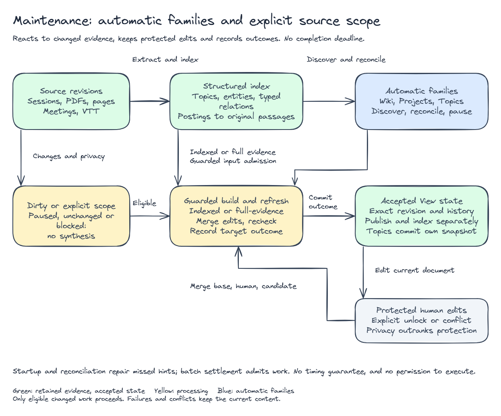

# Derived-view maintenance

Maintenance keeps editable knowledge in line with the current evidence without
throwing away what people have written. For how builds, citations, conflicts,
publication and history work, see [Derived Views](derived-views.md).

Views are on by default. A host can turn off all Views with
`TYPEAGENT_MEMORY_VIEW_DRAFTS=false`, or just the informational Wiki and Projects
with `TYPEAGENT_MEMORY_INFORMATIONAL_VIEWS=false`. Rehearsal budgets exist for
tests. They aren't a way to enable the product and aren't lifetime quotas.
Provider request throttling and application scheduling are separate things.

## Automatic and explicit work



[SVG](diagrams/view-maintenance.svg) · [Editable scene](diagrams/view-maintenance.excalidraw)

After indexing, automatic informational work finds and refreshes subjects. At
startup, and again every 30 seconds, a sweep repairs any dirty hints that were
missed. The sweep doesn't promise that synthesis finishes within 30 seconds.

While a durable bulk import is running, automatic Topics and Wiki/Projects work
waits until the last active batch finishes. You can still start a build by hand.
Privacy invalidation never waits for the synthesis schedule.

Each target has a bounded amount of work and a deadline. Finished targets stay
committed. Technical failures, unchanged-content rejections and human conflicts
are recorded separately. A provider or materialization failure gets one automatic
retry and is then parked. Changed evidence or recipe, or an explicit rebuild,
reopens it. Cancelling is always explicit. Recovery finishes publication and
index steps that were already committed. It doesn't repeat synthesis or create
duplicate versions.

## Indexed Wiki and Projects

`informational-wiki-v1` is the only supported Wiki construction contract, and
`informational-project-summary-v1` is the project contract. Both use bounded
indexed fragments and exact citations, with no full-source inventory.

Family operations `update`, `rebuild`, `pause` and `resume` use the existing job
and View store. Pause is durable. Stable IDs don't depend on display titles. Saved
selectors, aliases, exclusions, category and notes keep the editor's intent.

A subject needs substantial local evidence to get a page. It doesn't need several
sources, and there's no page quota. A passing mention of a service doesn't make an
initiative. Matching on case, whitespace or alias can propose that two items are
the same, but can't prove it. Explicit symbol names and project or episode scopes
that don't fit together stay separate or are marked ambiguous.

Retrieval favors relevant indexed evidence, corrections and qualifications, and a
mix of sources. It doesn't promise to find everything. Wiki pages state their
limits in the body and summary. A project page keeps owners, milestones, incident
closure, capacity qualification and overall project state apart. Who reviews
something isn't the same as who is accountable for the service, and a rehearsal
isn't a rollout.

The service rejects old `wiki-v1` bundles, inventory-backed Wiki and Projects,
and explicit-subject registries instead of migrating them. Old qualification
receipts don't become current contracts.

### Source overlap, admission and contribution

When a new automatic candidate shares sources or revisions with existing eligible
pages, the service compares them in a bounded way. Overlap suggests a comparison.
It doesn't show that the two pages have the same purpose. Admission has four outcomes:

- `distinct`: create a new independent page.
- `covered`: the existing prose already explains the key distinctions.
- `contribute`: refresh the page with the same scoped purpose using the missing evidence.
- `ambiguous`: record the possible destinations and wait for an explicit review.

Shared citations alone don't show that the prose covers a topic. A contribution
uses bounded original indexed evidence, keeps earlier qualifications, validates
the merged prose and binds only once the exact canonical revision is ready. A
failure or conflict doesn't mark the candidate complete. Existing article text is
used only to compare and merge, and it never counts as a new source.

## Editorial protection and consolidation

Deliberate human edits are protected at edit units the service can identify
reliably. The service exposes them as `protectedTargets`, and browser clients
don't guess. An explicit unlock saves your intent without rewriting text right
away, then schedules any eligible maintenance. An ordinary save doesn't trigger
another synthesis pass.

When a change matters, the service checks the merged prose for quantities and
cohorts, scope, corrections and withdrawals, and other critical distinctions.
Output without support is rejected as a technical failure and doesn't ask you for
blanket approval. If a human edit really overlaps, the existing recoverable
conflict path handles it.

Contributing a new candidate is different from consolidating existing generated
articles. The service can consolidate generated articles that are unprotected,
have no human edits in their history, and are shown by current original indexed
evidence to have one scoped purpose, as long as the output checks pass. Shared
infrastructure, vocabulary, source lists or topic parents only suggest a comparison.

Consolidation keeps unique sections, excerpts and citations. It commits the
canonical article before it turns on a redirect, then waits until the exact
derived index is ready. Reading an old ID returns the canonical identity and
anchor mappings, and historical reads are still available when requested. After
a restart, committed effects resume without another synthesis. Pages that humans
have edited are never retired automatically. Redirect cycles, deep ancestry and
changed targets block the operation, so they can't produce a retry loop. Consolidation
adds no new approval framework and doesn't merge entities authoritatively.

## Maintained Topics and source synopses

Topics are maintained navigation snapshots built from eligible original indexed
occurrences. They have source and revision citations, parent and related links,
summaries and limits. `queryTopics` pages through that projection, and
`rebuildTopics` uses the existing maintenance jobs. Editing a Topic's label or
alias doesn't make its generated summary human-authored evidence.

Source synopses are previews of one exact revision. Their status is pending,
ready, failed or unavailable, and they carry freshness and fidelity limits. A
failed synopsis doesn't block indexing or search for the source. Neither Topics
nor synopses count as independent corroboration, and neither proves that two
projects are the same.

## Explicit timeline and troubleshooting maintenance

These builders keep the full-evidence inventory and checks. Their definitions say
explicitly which sources continue to belong:

| Scope              | Membership                                                         |
| ------------------ | ------------------------------------------------------------------ |
| `pinned` or absent | Exactly the selected sources and events, with no automatic advance |
| `currentSources`   | The listed source IDs at their current ready revisions             |
| `scopedSources`    | Source types, all required tags and the exact `metadata.project`   |

Resolution lists every member. It doesn't use a truncated relevance result. A
scope that is missing, pending, inaccessible, empty or too large blocks with an
explicit error. Canonical event selection and time bounds stay fixed. Dynamic
scopes that pick up future events are not implemented.

An accepted checkpoint records a dependency fingerprint of eligible source content,
metadata and pipeline, plus the model, scope, time bounds and event evidence. If
nothing changed, the plan makes no synthesis calls. Failed, stale, cancelled or
conflicted work can't advance a checkpoint.

## Service and UI controls

The View-capable service, RPC, MCP and the browser share these guarded operations:

- `updateViewMaintenance`: save an explicit scope, with head and version guards.
- `planViewMaintenance`: preview targets without writing or synthesizing.
- `maintainViews`: admit explicit targets or control a family.
- `getViewMaintenance`: read a receipt and its current outcome.

Example, in a host with an initialized View-capable service:

```typescript
const { head } = await views.listViews(corpusId);
const result = await views.maintainViews({
  corpusId,
  expectedHead: head,
  family: "wiki",
  operation: "update",
});
const receipt = await views.getViewMaintenance({
  corpusId,
  receiptId: result.receiptId,
});
```

`result` has a `receiptId`, a `plan` and an optional `job`. A request may not
create a job. Unchanged, paused and blocked outcomes are reported explicitly.
`projects` and `topics` are separate families. Read the head again before your
next change.

The Memory Hub exposes family controls, explicit maintenance, editable content,
protect and unlock, publication and index state, and error messages. Polling
never replaces edits you haven't saved. The private-store CLI has the same
maintenance operations, but don't point it at the store of a running owner.

## Verification and limits

Source contracts: [maintenance types](https://github.com/microsoft/TypeAgent/blob/main/ts/packages/memory/service/src/viewMaintenanceTypes.ts),
[scheduler](https://github.com/microsoft/TypeAgent/blob/main/ts/packages/memory/service/src/fileMemoryService.ts),
[consolidation](https://github.com/microsoft/TypeAgent/blob/main/ts/packages/memory/service/src/wikiConsolidation.ts),
[Topics](https://github.com/microsoft/TypeAgent/blob/main/ts/packages/memory/service/src/topicTypes.ts).

Coverage: [maintenance](https://github.com/microsoft/TypeAgent/blob/main/ts/packages/memory/service/test/viewMaintenance.spec.ts),
[batch deferral](https://github.com/microsoft/TypeAgent/blob/main/ts/packages/memory/service/test/batchMaintenance.spec.ts),
[editorial updates](https://github.com/microsoft/TypeAgent/blob/main/ts/packages/memory/service/test/viewEditorial.spec.ts),
[consolidation recovery](https://github.com/microsoft/TypeAgent/blob/main/ts/packages/memory/service/test/wikiConsolidationRecovery.spec.ts).
The offline tests check lifecycle mechanics, not how well real models write.
Privacy removal and current evidence eligibility override every editing and
scheduling state. See [History and forgetting](derived-views.md#history-and-forgetting).
