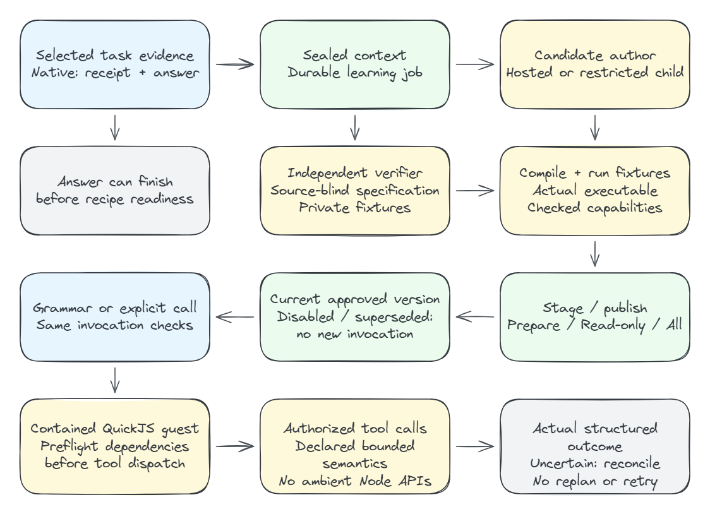
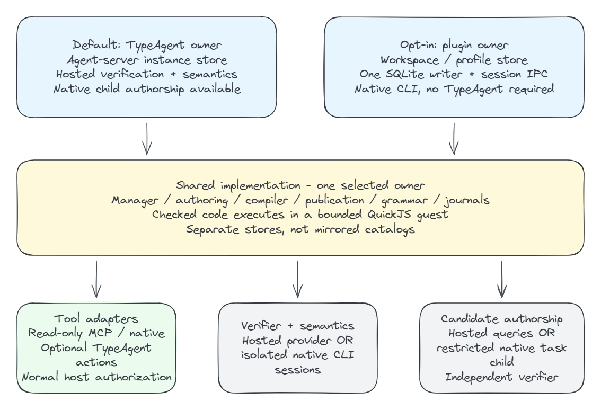

# Checked program macros

Macros turn a supported successful interaction into a reusable, versioned program.
They are distinct from [provider-owned flows](./workflows.md) and from the
separate [workflow DSL/IR design](./README.md). Copilot dev actions are a routing
path for Windows PowerShell actions, not another macro executor.

Only checked programs can be persisted, approved or run. The former step replay
engine, planning runner, adaptation APIs and execution switches are removed.
Grounded step/expression metadata remains authoring and audit evidence, not an
alternative runtime. Old development-only records are discarded, not migrated.

## Learning and execution are separate

[Full SVG](./diagrams/macro-program-lifecycle.svg) ·
[Editable scene](./diagrams/macro-program-lifecycle.excalidraw)

Learning produces an artifact; it is not a prerequisite repeated during execution:

1. **Capture supported evidence.** A selected native learning task needs a
   token-bound root success receipt followed by its final answer. Idle or a
   successful business tool alone is insufficient. The
   `typeagent_recorded_task_succeeded` tool records the caller's attestation,
   not an independent judgment of task correctness.
2. **Seal context and queue learning.** Explicit request, output and call evidence
   become a durable scoped job. No hidden parent reasoning is assumed. The
   original answer need not wait for the macro to become ready.
3. **Author and independently check.** Candidate authors receive explicit
   context. The verifier derives specifications and fixtures without candidate
   source; the candidate does not receive the verifier's private fixtures.
   Native author children have no business tools or recursive delegation.
4. **Compile and exercise the actual executable.** TypeScript diagnostics,
   schema/capability checks and observed plus changed-input/fresh-result fixtures
   gate publication. Passing these checks is not proof of semantic infallibility.
5. **Stage or publish.** The workspace learning preference controls whether a
   validated candidate needs explicit review. Learning failure is inspectable,
   not permission to run a draft or replay the original interaction.
6. **Invoke the current approved revision.** Grammar and explicit calls converge
   on `MacroManager.runMacro`. They execute stored code, not a planning child.
   Historic approval is audit evidence, not a route to a superseded version.

### Learning preferences are not permissions

| Preference | Publication behavior                                                                                         |
| ---------- | ------------------------------------------------------------------------------------------------------------ |
| Off        | No selected automatic learning; pending learning is cancelled. Existing approved macros are not revoked.     |
| Prepare    | Stage a checked candidate for explicit review and approval.                                                  |
| Read-only  | Auto-publish only when the host's inspected descriptors establish read-only effects.                         |
| All        | May auto-publish validated local candidates, still subject to the supported broker and normal authorization. |

The current production brokers reject writes even in All. Publication approval
never grants tool/backend permission. Dynamic PowerShell script authorization
is a separate contract; macro learning cannot bypass it.

### Waiting, interruption and readiness

Native contextual authoring uses durable requests, digests and leased replies.
`awaitingAuthor` means that a compatible author has not completed the required
phase; it is not a successful ready artifact or a fallback to another model.
New user work can preempt the exact owned child while leaving its lease
recoverable. Off or explicit cancellation cancels pending learning and rejects
late submissions. Completed phases and independent verifier responses are
checkpointed for restart.

The launcher correlates the exact child, prompt, result and native completion
event. A synchronous task RPC can return before that event, so the reply alone
is insufficient. The exact completed child is retired to prevent context reuse;
the parent session is not aborted.

Clients without contextual native capture retain the named TypeAgent-hosted
compatibility authoring path. A contextual job failure never silently switches
to it.

## One core, a selected owner

[Full SVG](./diagrams/macro-runtime-ownership.svg) ·
[Editable scene](./diagrams/macro-runtime-ownership.excalidraw)

| Owner                 | Coordination and storage                                                                                                                     | Tools and models                                                                                                                                                                                   |
| --------------------- | -------------------------------------------------------------------------------------------------------------------------------------------- | -------------------------------------------------------------------------------------------------------------------------------------------------------------------------------------------------- |
| `typeagent` (default) | Agent-server owns the manager, catalog, learning, publication, matching and runs.                                                            | Initial broker supports read-only MCP tools available to TypeAgent. Hosted model configuration supplies verification and declared semantics; native callers can supply restricted author children. |
| `plugin` (opt-in)     | The joined native extension owns one manager per workspace/profile. Hooks, commands and macro MCP tools use authenticated session-local IPC. | Native reads and explicitly classified read-only MCP tools; restricted task children author source. Independent verification and semantic functions use a separate installed native CLI.           |
| `off`                 | Disable recipe routing and learning; no alternate owner is selected automatically.                                                           | No permission to repeat an accepted invocation through another provider.                                                                                                                           |

These hosts reuse the shared authoring/compiler/runtime contracts and
publication semantics, not forked engines or mirrored catalogs.

Owner selection is independent of:

- Plugin routing mode: `direct`, `mcp`, `dev` or `bypass`. Bypass disables hook/MCP
  routing; a macro is not a fourth routing mode.
- Learning preference: Off, Prepare, Read-only or All.
- Tool permissions and backend authorization.

`TYPEAGENT_RECIPE_OWNER` overrides config `recipeOwner`. Use
`@typeagent recipe owner plugin` or `/typeagent-recipe-owner plugin`, then close
and restart the native session. Switching back to `typeagent` selects its
separate stored data; it does not migrate or synchronize recipes.

For installation, exact config and rollback, use the
[plugin setup guide](https://github.com/microsoft/TypeAgent/blob/main/ts/packages/copilot-plugin/README.md#checkpoint-c-plugin-owned-recipes).

### Plugin-local state and inference

State lives under the plugin data root's `recipes/<workspace-profile digest>/`.
`TYPEAGENT_RECIPE_PROFILE_ID` defaults to `local-default`. Node >=22.13 is
required for the lifetime SQLite writer lock. A second mutation owner fails;
close the existing session before transferring the same scope. The OS releases
the lock after a crash; there is no PID-based lock stealing. The old experimental
SQLite catalog is left untouched, not migrated.

Macro MCP clients resolve the actual registered native session/workspace/profile.
Their process may start in the plugin directory, which is not the recipe's
workspace. This registration does not copy a catalog.

The standalone verifier and semantic adapter create fresh tools-disabled sessions
on a **separate installed native CLI**, using ordinary CLI login. They do not use
same-process inference, inherited root context, ambient plugins/skills/MCP
discovery, TypeAgent config or API keys. The executable must be on PATH or selected
by `TYPEAGENT_RECIPE_CLI_PATH` / `recipeInferenceCliPath`; there is no shell or
bundled-SDK-runtime fallback.

The standalone facade can refresh tool/MCP registry generations between inference
calls while retaining owner identity. An account/workspace change or a generation
change during inference fails. The lower-level static-bound adapter remains
strict. Child-only events do not invalidate the root generation.

Copied plugin delivery includes TypeScript libraries, the QuickJS worker/WASM
closure, licenses and asset hashes. Installed CLI requirements are separate from
those bundled program-runtime assets.

## Execution, capabilities and failure

Program TypeScript is compiled to a checked executable and runs in a
worker-contained QuickJS/WASM guest, not Node `eval`, `vm` or the provider-flow
`new Function` helper. CPU/time, guest memory, stack, JSON and broker calls have
bounds. The guest uses declared capability and semantic adapters rather than
ambient process APIs.

- **Symbolic:** no model calls during repeat execution.
- **Hybrid:** only declared, bounded semantic calls through the configured
  provider, with schema validation, cancellation and model/token evidence.

Neither mode guarantees a total latency, speedup or cost reduction. Capture,
verification and publication may use models; tools, network and permissions can
dominate execution time.

Every declared capability is preflighted before the first program tool dispatch.
A failed preflight dispatches no program tools; it does not freeze external
contracts for the entire run. The plugin broker supports `view`, `rg`, `glob` and
exact read-only MCP identities configured in `recipeReadOnlyMcpTools`. Unknown
effects, writes, unsupported schemas and changed contracts fail explicitly.
Effect classification **does not grant permission**: native hooks, content
exclusions and ordinary host/backend authorization still apply.

The optional TypeAgent action adapter composes into this same host. It replaces
recorded protocol scopes/IDs with stable schema/action dependencies and concrete
parameters, resolves fresh contracts/scopes at execution and preserves completed
`{ output, results }`. The selected action must declare read-only effects; the
generic `typeagent-executeAction` wrapper is not blanket read-only. It uses
existing native MCP tools, not a second executor or extension-owned backend
connection. Native-only programs do not initialize the optional bridge.

Structured statuses remain distinct, including `requires_interaction` and
`execution_uncertain`. Supported confirmations/questions forward the actual
native user's answer, never model approval or a default. Rich forms/proposals,
learning interactive workflows and writes are unsupported. Fixture coverage does
not certify live interaction UI.

### Invocation and reconciliation

Use `search_macros`/`list_macros` to discover an unknown reference and
`get_macro_requirements` for inputs. `inspect_macro` is explicit review, not a
mandatory execution prerequisite. The MCP `run_macro` tool accepts `macroId`,
optional `version`, `inputs` and `timeoutMs`; its adapter allocates a unique run
ID. Direct manager callers supply the run ID themselves. Although the tool schema
accepts `dryRun`, the current program path explicitly rejects dry-run execution.

Run journals distinguish dispatched, completed and uncertain work. Report the
actual structured outcome and inspect `get_macro_run` for reconciliation.
Accepted failure, denial, cancellation or a lost/ambiguous reply never authorizes
native/planner/legacy fallback. Cancellation is not rollback. Disabling or
superseding a revision stops future use and future calls without undoing effects.

In plugin ownership, a clean unmatched prompt returns to native Copilot before
acceptance. An ambiguous or accepted failed invocation remains handled. Missing
owner context is an explicit unavailable condition, not a successful empty run.

## Data and privacy

The two owners retain separate data. TypeAgent places macro state beneath its
instance root; plugin ownership uses the scoped directory above. Do not open
either store with a competing manager while its owner is running.

Private captured evidence can retain full originals and large-result sidecars
even when ordinary histories or displayed values use redacted projections.
Filtering and previews are not secret-management or secure-erasure guarantees.
Limit capture, review local retention/ACLs, and do not embed credentials or live
session bindings in artifacts. Forget removes an active macro and retains
suppression/audit history; it does not erase immutable histories, backups or
external effects.

The Automations catalog aggregates provider inspection/management. It is not
one universal executor or synchronization between plugin and server stores.

## Current qualification and further reading

Native CLI synthetic proofs cover restricted authoring, copied no-TypeAgent
symbolic/hybrid execution and ready-artifact restart. Optional action-bridge
proof uses a real Dispatcher with a synthetic read-only provider. These do not
certify VS Code, every platform, production services, arbitrary effects,
plugin-update compatibility or performance. Interrupted-job handoff and
writer-lock crash recovery also have unit coverage; do not confuse those with a
live upgrade qualification.

- [Macro package contracts and persistence](https://github.com/microsoft/TypeAgent/blob/main/ts/packages/copilot-macros/README.md).
- [Plugin learning and owner setup](https://github.com/microsoft/TypeAgent/blob/main/ts/packages/copilot-plugin/README.md#tool-composed-macros).
- [Fast-action status ledger](https://github.com/microsoft/TypeAgent/blob/main/ts/docs/plans/copilot-fastActions/STATUS.md)
  for dated evidence and release gates; plans are repository-only, not site pages.
- [Provider flow architecture](./workflows.md) for PowerShell authorization,
  WebFlow/TaskFlow execution and provider-specific recovery.
