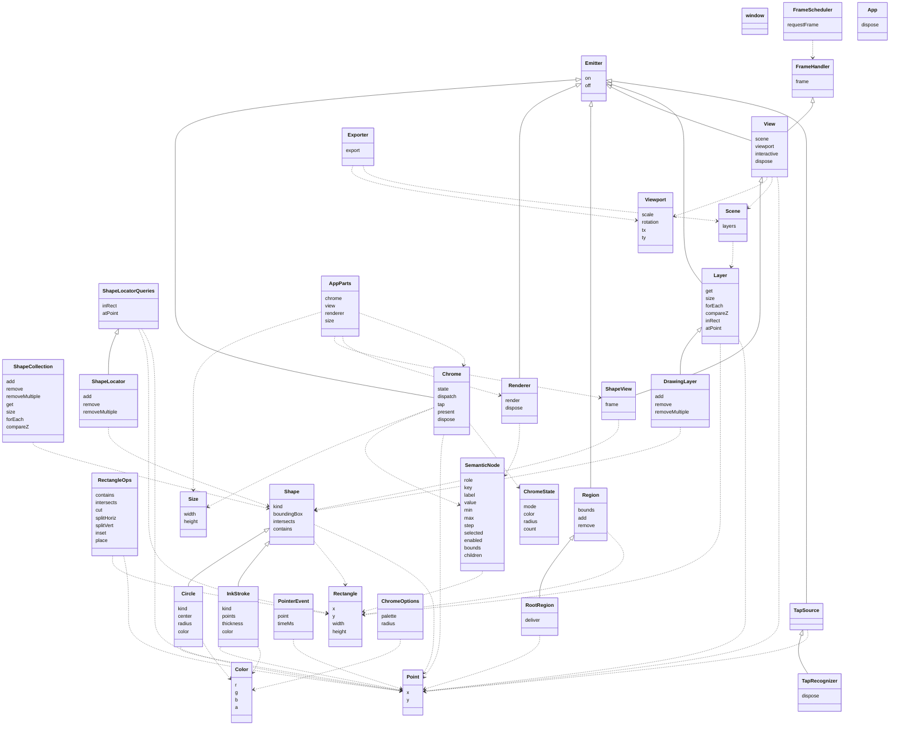

# Interface catalog

Generated by `npm run catalog` from `events.ts`, `geometry.ts`, `color.ts`, `shape.ts`, `window.ts`, `view.ts`, `shapeView.ts`, `pointer.ts`, `ui.ts`, `chrome.ts`, `app.ts`. Don't edit by hand. `catalog.html` is the interactive version.

Solid arrows with hollow heads are `extends`; dashed arrows are `uses` (a member or type parameter refers to the other interface).

## window

`window.ts`. Interfaces for a window's input and frames. A window gets input events and display frames from its platform, and both are per window: each window is on one display, and so has that display's refresh. Views, which are drawn in a window's frames, are in view.ts. Rules follow the format described in rules.ts.

| Rule | Tag | Headline | Status | Adversaries |
|---|---|---|---|---|
| `window.complete` | ensures | Each input event updates the model completely before its handler returns, so nothing is left pending and no frame shows part of an action: running the frames afterward changes neither the model nor the controls presented. | tested | 1 |
| `window.fraction-of-frame` | budget | A pen move or an eraser move updates the model in under 5% of a 120 Hz frame (about 0.42 ms), with 10,000 strokes in the document. | budget: not measured yet |  |

## Emitter

`events.ts`. Something that emits events. Each call to on adds one registration of a listener for one event, even if that listener is already registered.

| Rule | Tag | Headline | Status | Adversaries |
|---|---|---|---|---|
| `Emitter.order` | ensures | An emit calls its listeners in the order they were registered. | tested | 1 |
| `Emitter.snapshot` | ensures | An emit calls the listeners registered when it started: a listener added during the emit isn't called by it, and one removed during it still is. | tested | 1 |
| `Emitter.on.notified` | ensures | Each emit of the event calls the listener once for each of its registrations, synchronously, before the emit returns. | tested | 2 |
| `Emitter.off.removes-one` | ensures | Removes exactly one registration, the most recent, when there is one, and nothing otherwise. | tested | 4 |

## Point

`geometry.ts`. A location, in the coordinate space its use states.

No rules of its own.

## Rectangle

`geometry.ts`. An axis-aligned rectangle covering the half-open region [x, x + width) × [y, y + height). (x, y) is the top-left corner. The left and top edges are inside, and the right and bottom edges are not, so two rectangles that share only an edge do not overlap. A rectangle with width 0 or height 0 is empty and contains no points.

| Rule | Tag | Headline | Status | Adversaries |
|---|---|---|---|---|
| `Rectangle.non-negative-size` | valid | Width and height are never negative. | tested | 1 |

## RectangleOps

`geometry.ts`. Operations on rectangles, following Rectangle's half-open semantics.

| Rule | Tag | Headline | Status | Adversaries |
|---|---|---|---|---|
| `RectangleOps.no-mutation` | ensures | Never modifies its arguments. | tested |  |
| `RectangleOps.contains.half-open` | ensures | Left and top edges are inside; right and bottom edges are not. | tested |  |
| `RectangleOps.intersects.nonzero-area` | ensures | True only for overlap of nonzero area; shared edges, corners and empty rectangles don't count. | tested |  |
| `RectangleOps.intersects.symmetric` | ensures | The order of the arguments doesn't matter. | tested |  |
| `RectangleOps.cut.non-negative` | requires | size is at least 0. | caller's obligation |  |
| `RectangleOps.cut.exact` | ensures | Returns the strip and the rest as cutRect defines them. | tested | 2 |
| `RectangleOps.splitHoriz.weights` | requires | At least one weight, and every weight greater than 0. | caller's obligation |  |
| `RectangleOps.splitHoriz.exact` | ensures | Returns the rectangles splitRect defines: widths by largest remainder, side by side, tiling r. | tested | 3 |
| `RectangleOps.splitVert.weights` | requires | At least one weight, and every weight greater than 0. | caller's obligation |  |
| `RectangleOps.splitVert.exact` | ensures | Returns the rectangles splitRect defines: heights by largest remainder, stacked, tiling r. | tested | 1 |
| `RectangleOps.inset.non-negative` | requires | d is at least 0. | caller's obligation |  |
| `RectangleOps.inset.exact` | ensures | Returns the rectangle insetRect defines. | tested | 2 |
| `RectangleOps.place.non-negative` | requires | The size's width and height are at least 0. | caller's obligation |  |
| `RectangleOps.place.exact` | ensures | Returns the rectangle placeRect defines. | tested | 2 |

## Viewport

`geometry.ts`. A 2D similarity transform (uniform scale, rotation, translation) from canonical coordinates to view coordinates (see the top of this file); each view applies its own pixel density on top.

| Rule | Tag | Headline | Status | Adversaries |
|---|---|---|---|---|
| `Viewport.positive-scale` | valid | Scale is greater than 0. | tested | 1 |

## Color

`color.ts`. An sRGB color with straight (not premultiplied) alpha.

| Rule | Tag | Headline | Status | Adversaries |
|---|---|---|---|---|
| `Color.rgb-range` | valid | r, g and b are integers from 0 to 255. | tested |  |
| `Color.alpha-range` | valid | a is from 0 (transparent) to 1 (opaque). | tested | 1 |

## Shape

`shape.ts`. A region of the plane, such as an ink stroke.

| Rule | Tag | Headline | Status | Adversaries |
|---|---|---|---|---|
| `Shape.deterministic` | ensures | Every method returns the same result each time it is called with the same arguments. | tested |  |
| `Shape.boundingBox.exact` | abstract | The rectangle is exactly the shape's extents; each shape type states this for its own geometry. | abstract: refined by `InkStroke.box`, `Circle.box` |  |
| `Shape.intersects.empty-rect` | ensures | Never intersects an empty rectangle. | tested |  |
| `Shape.intersects.implies-box` | ensures | If the shape intersects r, so does its bounding box. | tested |  |
| `Shape.intersects.witness` | ensures | If some point is in both the shape and r, they intersect. | tested |  |
| `Shape.intersects.only-shared` | abstract | Intersects r only when some point is in both; each shape type states this for its own geometry. | abstract: refined by `InkStroke.exact-intersects`, `Circle.exact-intersects` |  |
| `Shape.contains.implies-box` | ensures | Every point in the shape is in its bounding box. | tested |  |

## InkStroke

`shape.ts`. A stroke of digital ink: a polyline drawn with a round pen. Consecutive duplicate points are allowed. Color does not affect geometry.

| Rule | Tag | Headline | Status | Adversaries |
|---|---|---|---|---|
| `InkStroke.has-points` | valid | Has at least one point; a single point draws a dot. | tested |  |
| `InkStroke.min-thickness` | valid | Thickness is at least 1. | tested |  |
| `InkStroke.box` | ensures | The bounding box is the points' extents, grown by half the thickness. | tested |  |
| `InkStroke.round-pen` | ensures | Covers every point within half the thickness of the polyline that lies in its bounding box as computed. | tested |  |
| `InkStroke.exact-intersects` | ensures | Intersects r exactly when some point it contains is in r; when the pen only touches r, contains() decides. | tested | 1 |

## Circle

`shape.ts`. A filled circle: the points within radius of center, with the half-open rule at its maximum x and y. It covers the same region as a one-point InkStroke with thickness 2 * radius, and its rules are those rules with [center] as the polyline.

| Rule | Tag | Headline | Status | Adversaries |
|---|---|---|---|---|
| `Circle.positive-radius` | valid | The radius is greater than 0. | tested |  |
| `Circle.box` | ensures | The bounding box is the center grown by the radius. | tested | 1 |
| `Circle.disk` | ensures | Covers every point within the radius of the center that lies in its bounding box as computed. | tested | 2 |
| `Circle.exact-intersects` | ensures | Intersects r exactly when some point it contains is in r; when the circle only touches r, contains() decides. | tested | 2 |

## ShapeCollection

`shape.ts`. A collection of shapes, kept in z-order. Indexes such as a ShapeLocator hold only IDs and geometry. A view shows a collection through a Layer (view.ts) that presents it.

| Rule | Tag | Headline | Status | Adversaries |
|---|---|---|---|---|
| `ShapeCollection.size` | invariant | size counts the shapes forEach visits. | tested | 1 |
| `ShapeCollection.z-order` | invariant | forEach visits each shape once, from bottom to top. | tested | 1 |
| `ShapeCollection.get-agrees` | invariant | get returns exactly the shapes forEach visits, under the same IDs. | tested | 1 |
| `ShapeCollection.observers-read-only` | ensures | get, size, forEach and compareZ never change the collection. | tested | 1 |
| `ShapeCollection.add.gettable` | ensures | The new ID retrieves the shape. | tested | 1 |
| `ShapeCollection.add.on-top` | ensures | The new shape is above every other shape. | tested | 1 |
| `ShapeCollection.add.fresh-id` | ensures | Never returns an ID it has returned before, even for a shape that was later removed. | tested | 2 |
| `ShapeCollection.add.others-kept` | ensures | Every other shape keeps its ID and its place in z-order. | tested | 1 |
| `ShapeCollection.remove.result` | ensures | Returns whether the shape was present. | tested | 1 |
| `ShapeCollection.remove.gone` | ensures | The shape is no longer retrievable. | tested | 1 |
| `ShapeCollection.remove.others-kept` | ensures | Every other shape keeps its ID and its place in z-order. | tested | 1 |
| `ShapeCollection.removeMultiple.count` | ensures | Returns the number of shapes actually removed. | tested | 1 |
| `ShapeCollection.removeMultiple.gone` | ensures | None of the listed shapes is retrievable. | tested | 1 |
| `ShapeCollection.removeMultiple.same-as-remove` | ensures | Has the same effect as calling remove() on each ID, in any order. | tested | 3 |
| `ShapeCollection.compareZ.present` | requires | Both shapes are in the collection. | caller's obligation |  |
| `ShapeCollection.compareZ.zero-iff-same` | ensures | Returns 0 only when comparing a shape with itself. | tested | 1 |
| `ShapeCollection.compareZ.antisymmetric` | ensures | Swapping the arguments flips the sign. | tested | 1 |

## ShapeLocatorQueries

`shape.ts`. Finds shapes by location. Read-only: code that only looks shapes up gets this, so it can't change what is indexed.

| Rule | Tag | Headline | Status | Adversaries |
|---|---|---|---|---|
| `ShapeLocatorQueries.no-retain` | ensures | Never keeps a reference to out after returning: later calls leave earlier out arrays unchanged. | tested | 1 |
| `ShapeLocatorQueries.read-only` | ensures | Queries never change what is indexed. | tested | 2 |
| `ShapeLocatorQueries.inRect.exact` | ensures | Reports exactly the indexed shapes that intersect r. | tested | 8 |
| `ShapeLocatorQueries.inRect.once` | ensures | Reports each ID at most once. | tested | 1 |
| `ShapeLocatorQueries.inRect.append` | ensures | Leaves what was already in out unchanged. | tested | 1 |
| `ShapeLocatorQueries.inRect.count` | ensures | Returns the number of IDs appended. | tested | 1 |
| `ShapeLocatorQueries.atPoint.exact` | ensures | Reports exactly the indexed shapes that contain p. | tested | 5 |
| `ShapeLocatorQueries.atPoint.once` | ensures | Reports each ID at most once. | tested | 1 |
| `ShapeLocatorQueries.atPoint.append` | ensures | Leaves what was already in out unchanged. | tested | 1 |
| `ShapeLocatorQueries.atPoint.count` | ensures | Returns the number of IDs appended. | tested | 1 |

## ShapeLocator

`shape.ts`. A spatial index that finds shapes by location, such as a quadtree. It holds IDs and geometry only; the ShapeCollection is the authority on what exists. A collection and a locator are separate: whether a collection has a locator is the choice of the code that owns both, which keeps them in sync.

| Rule | Tag | Headline | Status | Adversaries |
|---|---|---|---|---|
| `ShapeLocator.any-extent` | ensures | Accepts any shape that satisfies add's in-range rule; there is no fixed extent. | tested | 2 |
| `ShapeLocator.add.new-id` | requires | The ID is not already indexed. | caller's obligation |  |
| `ShapeLocator.add.in-range` | requires | The shape's bounding box lies within ±1e300, right and bottom edges included. | caller's obligation |  |
| `ShapeLocator.add.indexed` | ensures | Afterward, inRect finds the shape by its own bounding box, if the shape intersects that box. | tested |  |
| `ShapeLocator.remove.result` | ensures | Returns whether the ID was indexed. | tested | 2 |
| `ShapeLocator.remove.gone` | ensures | No query finds the ID afterward, until it is added again. | tested |  |
| `ShapeLocator.removeMultiple.count` | ensures | Returns the number of IDs actually removed. | tested | 1 |
| `ShapeLocator.removeMultiple.same-as-remove` | ensures | Has the same effect as calling remove() on each ID, in any order. | tested | 2 |

## FrameHandler

`window.ts`. Something that does its work during a display frame.

No rules of its own.

## FrameScheduler

`window.ts`. Calls handlers before the window's next display refresh. Implemented with requestAnimationFrame on the web, CADisplayLink on iOS and Choreographer on Android. Each window has its own.

| Rule | Tag | Headline | Status | Adversaries |
|---|---|---|---|---|
| `FrameScheduler.requestFrame.merged` | ensures | Repeated requests with the same handler before a frame call its frame() once in that frame. | tested | 1 |
| `FrameScheduler.requestFrame.not-synchronous` | ensures | Never calls frame() before requestFrame returns. | tested | 1 |
| `FrameScheduler.requestFrame.next-frame` | ensures | A request made during a frame calls frame() in the following frame, not the current one. | tested | 1 |

## TapSource

`window.ts`. Taps on one surface, as its platform recognizes them: a press and release close together in place and time, by mouse, pen or touch. Recognizing a tap from the platform's own events is the platform's job; a tap carries only where it happened, in the surface's coordinates: layout units, with (0, 0) at its top left.

No rules of its own.

## Layer

`view.ts`. One layer of a scene: items in z-order, found by location, emitting change when they change. A layer presents some source of data, such as a ShapeCollection with a ShapeLocator, and is read-only: changes are made to the source, and the layer shows them. regions(this) is the region of the plane each item covers, as the source defines it (see view.vocab.ts).

| Rule | Tag | Headline | Status | Adversaries |
|---|---|---|---|---|
| `Layer.size` | invariant | size counts the items forEach visits. | tested | 1 |
| `Layer.z-order` | invariant | forEach visits each item once, from bottom to top. | tested | 1 |
| `Layer.get-agrees` | invariant | get returns exactly the items forEach visits, under the same IDs. | tested | 1 |
| `Layer.stable` | ensures | While an ID is present, get returns the same item for it. | tested | 1 |
| `Layer.no-reuse` | ensures | An ID that has gone never comes back. | tested | 2 |
| `Layer.read-only` | ensures | Reading, querying, on and off never change the items. | tested | 2 |
| `Layer.no-retain` | ensures | Never keeps a reference to a query's out array after returning: later calls leave earlier out arrays unchanged. | tested | 1 |
| `Layer.notifies` | ensures | After a change to the source that changes the items, emits change once before the change returns, when every observer and query already shows the new items. | tested | 8 |
| `Layer.quiet` | ensures | Emits change only as notifies says. | tested | 4 |
| `Layer.compareZ.present` | requires | Both items are in the layer. | caller's obligation |  |
| `Layer.compareZ.zero-iff-same` | ensures | Returns 0 only when comparing an item with itself. | tested | 1 |
| `Layer.compareZ.antisymmetric` | ensures | Swapping the arguments flips the sign. | tested | 1 |
| `Layer.inRect.exact` | ensures | Reports exactly the items whose regions intersect r. | tested | 1 |
| `Layer.inRect.once` | ensures | Reports each ID at most once. | tested | 1 |
| `Layer.inRect.append` | ensures | Leaves what was already in out unchanged. | tested | 1 |
| `Layer.inRect.count` | ensures | Returns the number of IDs appended. | tested | 1 |
| `Layer.atPoint.exact` | ensures | Reports exactly the items whose regions contain p. | tested | 1 |
| `Layer.atPoint.once` | ensures | Reports each ID at most once. | tested | 1 |
| `Layer.atPoint.append` | ensures | Leaves what was already in out unchanged. | tested | 1 |
| `Layer.atPoint.count` | ensures | Returns the number of IDs appended. | tested | 1 |

## Scene

`view.ts`. What views draw: layers in canonical coordinates, the same for every view, with no viewport. layers[0] is the bottom layer. Layers are drawn bottom to top, and each layer's items in that layer's z-order.

No rules of its own.

## View

`view.ts`. Shows a scene on screen through a viewport, and stays current. A view for a particular data model, such as ShapeView, draws its items for its platform's surface.

| Rule | Tag | Headline | Status | Adversaries |
|---|---|---|---|---|
| `View.tap-coordinates` | requires | The tap source is for the view's own surface: it emits points in the view's coordinates. | caller's obligation |  |
| `View.layer-change` | ensures | When a layer changes, requests a frame and draws nothing until frame(). | tested | 2 |
| `View.idle` | ensures | Requests no frame while nothing it shows changes. | tested | 1 |
| `View.one-listener` | ensures | Until disposed, has exactly one listener registered on each layer of its scene, and one on its tap source. | tested | 2 |
| `View.read-only` | ensures | Reading scene, viewport or interactive changes nothing: what it shows, its frame requests and its listeners stay as they were. | tested | 1 |
| `View.taps` | ensures | While interactive and not disposed, each tap from its tap source emits tap once, with the tap's point in canonical coordinates, before the source's emit returns; for the identity viewport that is the same point. | tested | 2 |
| `View.viewport.set-redraws` | deferred | Setting a different viewport requests a frame, and that frame draws through the new viewport. | deferred: when a ShapeView supports viewports other than the identity. |  |
| `View.viewport.set-equal` | ensures | Setting a viewport equal to the current one, field by field, requests no frame and emits nothing. | tested | 1 |
| `View.viewport.set-emits` | deferred | Setting a different viewport emits viewport with the new value before the setter returns. | deferred: when a ShapeView supports viewports other than the identity. |  |
| `View.interactive.starts-false` | ensures | A new view is not interactive. | tested | 1 |
| `View.interactive.ignores-input` | ensures | While false, input emits nothing and changes neither the viewport nor the model; so far, taps emit no tap. | tested | 1 |
| `View.dispose.detaches` | ensures | Afterward, the view has no listeners on the scene's layers or its tap source, and layer changes request no frame. | tested | 1 |
| `View.dispose.inert` | ensures | Afterward, frame() draws nothing, including a frame requested before dispose. | tested | 2 |

## Exporter

`view.ts`. Produces a document (SVG, PDF and so on) from a scene, once, on request. An exporter for a particular data model draws its items in its format. Not a view: it has no frames, listeners or input. Give it a scene of the document's layers, without the transient ones.

No rules of its own.

## ShapeView

`shapeView.ts`. A view of shapes. It draws each kind of shape itself, on its platform's surface; for now the only kind is Circle. painted(this, p) (shapeView.vocab.ts) is what the view shows at point p.

| Rule | Tag | Headline | Status | Adversaries |
|---|---|---|---|---|
| `ShapeView.fixed-layers` | requires | The scene's list of layers doesn't change while the view exists; the items in each layer may. The view starts listening to each layer when it is created. | caller's obligation |  |
| `ShapeView.circles-only` | requires | Every item in the scene is a Circle; other kinds are outside the rules until their drawing is specified. | caller's obligation |  |
| `ShapeView.first-frame` | ensures | Requests a frame when created, so that its first frame shows the scene. | tested | 1 |
| `ShapeView.frame.paints` | ensures | Afterward, each point of the surface that is on no circle's edge shows the circles containing it, composited bottom to top. | tested | 5 |

## DrawingLayer

`shapeView.ts`. A layer of shapes with edits, for code that changes what a layer shows, such as an app's controls (chrome.ts). Each item is its own shape and its own region. ShapeLayer is one: it presents a ShapeCollection with a ShapeLocator, and its edits change both.

| Rule | Tag | Headline | Status | Adversaries |
|---|---|---|---|---|
| `DrawingLayer.add.on-top` | ensures | The shape becomes the top item, under the returned ID, which wasn't present before; the other items stay, in the same order. | tested | 1 |
| `DrawingLayer.remove.result` | ensures | Returns whether the item was present; afterward it isn't, and the other items stay, in the same order. | tested | 1 |
| `DrawingLayer.removeMultiple.result` | ensures | Returns the number of items removed; the other items stay, in the same order. | tested | 1 |

## PointerEvent

`pointer.ts`. One mouse event, as a region receives it.

No rules of its own.

## Region

`pointer.ts`. A rectangle of the window that components subscribe to. Its bounds are in its parent's region-local coordinates, or in window coordinates for the root. Regions nest: a child lies inside its parent, and siblings don't overlap, so every point of the window lies in one path of regions from the root.

| Rule | Tag | Headline | Status | Adversaries |
|---|---|---|---|---|
| `Region.add.inside` | requires | rect lies within this region: from (0, 0) to its width and height. | caller's obligation |  |
| `Region.add.disjoint` | requires | rect doesn't overlap any child this region already has. | caller's obligation |  |
| `Region.add.attached` | requires | This region hasn't been removed. | caller's obligation |  |
| `Region.add.adds` | ensures | Returns a new region with bounds equal to rect and no children or listeners. | tested | 1 |
| `Region.remove.detaches` | ensures | Afterward neither it nor any region under it emits anything, and its parent no longer counts it as a child. | tested |  |

## RootRegion

`pointer.ts`. The root of a window's regions. The platform delivers mouse events to it in window coordinates; its bounds are the window, at (0, 0).

| Rule | Tag | Headline | Status | Adversaries |
|---|---|---|---|---|
| `RootRegion.presses-alternate` | requires | The platform delivers down only when no press is in progress. An up may come with no press in progress, from a press that started outside the window. | caller's obligation |  |
| `RootRegion.innermost-listener` | ensures | With no press in progress, a down, a move or an up at a point is received by the innermost region that contains the point and has a listener for that kind of event, and by no other region; when no region qualifies, by none. | tested | 7 |
| `RootRegion.capture` | ensures | When a region receives a down, it captures the press: every move and up until the press ends is received by that region if it has a listener for that kind, wherever the point is, and by no other region. | tested | 1 |
| `RootRegion.released-capture` | ensures | When the capturing region is removed during a press, the rest of the press's events are received by no region. | tested | 1 |
| `RootRegion.uncaptured` | ensures | When no region receives a down, the rest of its press's events are received by no region. | tested | 1 |
| `RootRegion.local` | ensures | A received event's point is the delivered point minus the receiving region's top left in window coordinates, and its time is the delivered time. | tested | 2 |

## TapRecognizer

`pointer.ts`. Taps from a region's presses: a TapSource (window.ts) for a component that needs only taps, such as a view. It is made with a region and a slop, the distance in layout units a press may wander and still be a tap.

| Rule | Tag | Headline | Status | Adversaries |
|---|---|---|---|---|
| `TapRecognizer.taps` | ensures | When its region receives a down and then the up that ends the press, and neither that up nor any move between is farther than the slop from the down, emits tap once with the down's point, before the up's emit returns. | tested | 4 |
| `TapRecognizer.only-taps` | ensures | Emits nothing else. | tested | 2 |
| `TapRecognizer.one-listener` | ensures | Until disposed, has exactly one listener on each of its region's down, move and up. | tested | 1 |
| `TapRecognizer.dispose.detaches` | ensures | Afterward, has no listeners on its region and emits nothing. | tested | 1 |

## Size

`ui.ts`. A size in layout units.

No rules of its own.

## SemanticNode

`ui.ts`. One control or container. Fields that don't apply to a role are absent, not undefined. A tree is plain data: comparing two trees with deepEqual says whether they present the same thing.

| Rule | Tag | Headline | Status | Adversaries |
|---|---|---|---|---|
| `SemanticNode.well-formed` | valid | Each node has exactly the fields its role uses, as wellFormed (ui.vocab.ts) checks: value, min, max and step on a slider, with step > 0 and min <= value <= max, value being min plus a whole number of steps; value as a string on text; selected on a radio; children only on group, toolbar and radio-group, and only radios in a radio-group. | tested |  |
| `SemanticNode.unique-keys` | valid | Keys are unique within the tree. | tested |  |
| `SemanticNode.inside` | valid | Each child's bounds lie within its parent's. | tested |  |
| `SemanticNode.disjoint` | valid | Siblings' bounds don't overlap, so every point of the window belongs to one path from the root, and a platform's hit testing finds the same node as pointer routing (pointer.ts). | tested |  |

## Renderer

`ui.ts`. Presents a semantic tree with the platform's widgets, and reports what the user does with them. It knows nothing of what the controls mean: whoever listens to input decides that, and renders a new tree when anything changes.

| Rule | Tag | Headline | Status | Adversaries |
|---|---|---|---|---|
| `Renderer.starts-empty` | ensures | Presents nothing until the first render. | tested |  |
| `Renderer.reports` | ensures | When the user activates an enabled button, or an enabled radio that isn't selected, emits input once with kind activate and the control's key; when the user sets an enabled slider to a value, emits input once with kind set-value, its key and that value. Each before the user's action completes. | tested | 1 |
| `Renderer.silent` | ensures | Emits nothing for any other action: on a disabled control, on a selected radio, or on a node that isn't a button, radio or slider. | tested | 2 |
| `Renderer.stable` | ensures | A node whose key is in both the old tree and the new one, with the same role, stays the same platform widget across a render, so that focus and a drag in progress survive it. | tested | 1 |
| `Renderer.render.well-formed` | requires | tree holds SemanticNode's @valid rules. | caller's obligation |  |
| `Renderer.render.presents` | ensures | Afterward, the platform presents exactly tree. | tested | 4 |
| `Renderer.render.quiet` | ensures | Emits nothing. | tested | 1 |
| `Renderer.dispose.removes` | ensures | Afterward, presents nothing, emits nothing, and later renders do nothing. | tested | 1 |

## ChromeOptions

`chrome.ts`. What a chrome offers. Options that break these rules are outside the rules.

| Rule | Tag | Headline | Status | Adversaries |
|---|---|---|---|---|
| `ChromeOptions.palette` | valid | At least one color, and labels that are distinct and not empty. | tested |  |
| `ChromeOptions.radius-range` | valid | 0 < min <= initial <= max, step > 0, and max and initial are min plus whole numbers of steps. | tested |  |

## ChromeState

`chrome.ts`. Everything the controls show.

No rules of its own.

## Chrome

`chrome.ts`. The model behind the controls.

| Rule | Tag | Headline | Status | Adversaries |
|---|---|---|---|---|
| `Chrome.starts` | ensures | A new chrome is in draw mode, with the first color, the initial radius, and the layer's size as its count. | tested | 1 |
| `Chrome.one-listener` | ensures | Until disposed, has exactly one change listener on its layer. | tested | 1 |
| `Chrome.counts` | ensures | After the layer changes, from any source, count is the layer's size before the layer's emit returns. | tested | 1 |
| `Chrome.emits` | ensures | Emits change once each time its state changes, after the state is updated, and never when it stays equal. | tested | 2 |
| `Chrome.state.snapshot` | ensures | A state read earlier keeps its values when the chrome changes later. | tested | 1 |
| `Chrome.dispatch.mode` | ensures | Activating mode.draw or mode.erase sets that mode. | tested | 1 |
| `Chrome.dispatch.color` | ensures | Activating color.<i> sets color i. | tested | 1 |
| `Chrome.dispatch.radius` | ensures | Setting radius to v sets the radius to v moved onto the slider's steps and range, as snapRadius says. | tested | 2 |
| `Chrome.dispatch.clear` | ensures | Activating clear, when enabled, removes every item from the layer with one removeMultiple. | tested | 1 |
| `Chrome.dispatch.ignores` | ensures | An event for a key that isn't a control, for a disabled control, or of the wrong kind for its control changes nothing and emits nothing. | tested | 2 |
| `Chrome.tap.draws` | ensures | In draw mode, adds to the top of the layer a circle centered at p, with the current radius and color. | tested | 1 |
| `Chrome.tap.erases` | ensures | In erase mode, removes the topmost item that contains p, if there is one, and otherwise changes nothing. | tested | 2 |
| `Chrome.present.fits` | requires | The window is at least minimumSize(options(this)). | caller's obligation |  |
| `Chrome.present.exact` | ensures | Returns the tree the table above describes. | tested | 1 |
| `Chrome.present.pure` | ensures | Changes nothing and emits nothing. | tested | 1 |
| `Chrome.dispose.detaches` | ensures | Afterward, has no listener on its layer, and dispatch and tap change nothing and emit nothing. | tested | 1 |

## AppParts

`app.ts`. The parts an app connects, each already made, and the window's size.

No rules of its own.

## App

`app.ts`. Connected parts. An app is made by a function that takes AppParts and owns them from then on.

| Rule | Tag | Headline | Status | Adversaries |
|---|---|---|---|---|
| `App.same-layer` | requires | The chrome's layer is one of the layers the view draws. | caller's obligation |  |
| `App.fits` | requires | The size is at least the chrome's minimum size. | caller's obligation |  |
| `App.starts` | ensures | When made, renders the chrome's controls for the size, and makes the view interactive. | tested | 2 |
| `App.renders` | ensures | Each time the chrome emits change, renders its controls for the size once, before the chrome's emit returns. | tested | 2 |
| `App.forwards-input` | ensures | Each input the renderer emits goes to the chrome's dispatch once, unchanged, before the renderer's emit returns. | tested | 1 |
| `App.forwards-taps` | ensures | Each tap the view emits goes to the chrome's tap once, unchanged, before the view's emit returns. | tested | 1 |
| `App.one-listener` | ensures | Until disposed, has exactly one listener on each of the chrome's change, the renderer's input and the view's tap. | tested | 1 |
| `App.dispose.detaches` | ensures | Afterward, has no listeners on its parts, and each part has been disposed once. | tested | 3 |
