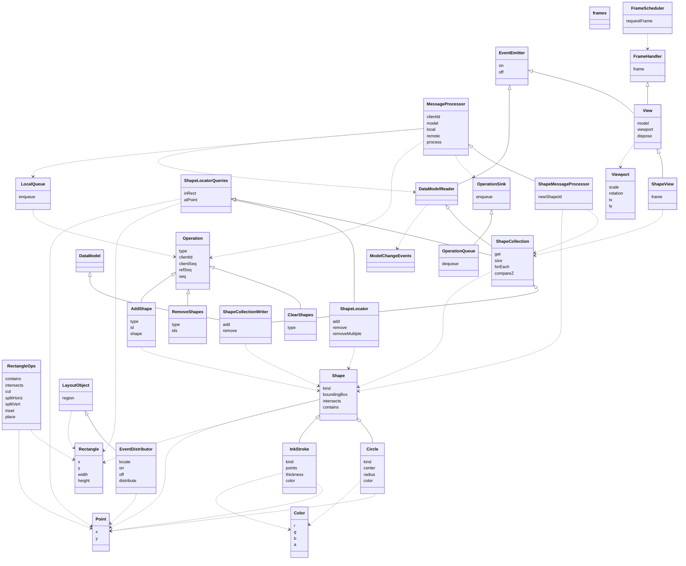

# Interface catalog

Generated by `npm run catalog` from `events.ts`, `geometry.ts`, `color.ts`, `shape.ts`, `dataModel.ts`, `shapeModel.ts`, `frames.ts`, `view.ts`, `shapeView.ts`, `layout.ts`. Don't edit by hand. `catalog.html` is the interactive version.

Solid arrows with hollow heads are `extends`; dashed arrows are `uses` (a member or type parameter refers to the other interface).

## frames

`frames.ts`. Display frames. Each window is on one display, has that display's refresh, and has its own FrameScheduler.

| Rule | Tag | Headline | Status | Adversaries |
|---|---|---|---|---|
| `frames.complete` | ensures | Each input event's handler sends every operation of its action (LocalSend, dataModel.ts) before it returns, so no frame shows part of an action: once the message infrastructure has processed what was sent, running the frames and processing again don't change the model. | tested | 2 |
| `frames.processed-before-frame` | deferred | The message infrastructure processes what an input event's handler sent before the next frame draws, so that frames.complete holds on every platform. | deferred: when the message infrastructure is specified. |  |
| `frames.fraction-of-frame` | budget | Sending and processing the operations of an eraser move, or of finishing a pen stroke, takes under 5% of a 120 Hz frame (about 0.42 ms), with 10,000 strokes in the model. | budget: not measured yet |  |

## EventEmitter

`events.ts`. Something that emits events. Each call to on adds one registration of a listener for one event, even if that listener is already registered.

| Rule | Tag | Headline | Status | Adversaries |
|---|---|---|---|---|
| `EventEmitter.order` | ensures | An emit calls its listeners in the order they were registered. | tested | 1 |
| `EventEmitter.snapshot` | ensures | An emit calls the listeners registered when it started: a listener added during the emit isn't called by it, and one removed during it still is. | tested | 1 |
| `EventEmitter.on.notified` | ensures | Each emit of the event calls the listener once for each of its registrations, synchronously, before the emit returns. | tested | 2 |
| `EventEmitter.off.removes-one` | ensures | Removes exactly one registration, the most recent, when there is one, and nothing otherwise. | tested | 4 |

## Point

`geometry.ts`. A location, in the coordinate space its use states.

No rules of its own.

## Rectangle

`geometry.ts`. An axis-aligned rectangle covering the half-open region [x, x + width) × [y, y + height). (x, y) is the top-left corner. The left and top edges are inside, and the right and bottom edges are not, so two rectangles that share only an edge do not overlap. A rectangle with width 0 or height 0 is empty and contains no points.

| Rule | Tag | Headline | Status | Adversaries |
|---|---|---|---|---|
| `Rectangle.non-negative-size` | valid | Width and height are never negative. | tested | 1 |

## RectangleOps

`geometry.ts`. Operations on rectangles, following Rectangle's half-open semantics. cut, splitHoriz, splitVert, inset and place are each defined exactly by their reference functions in geometry.vocab.ts.

| Rule | Tag | Headline | Status | Adversaries |
|---|---|---|---|---|
| `RectangleOps.no-mutation` | ensures | Never modifies its arguments. | tested |  |
| `RectangleOps.contains.half-open` | ensures | Left and top edges are inside; right and bottom edges are not. | tested |  |
| `RectangleOps.intersects.nonzero-area` | ensures | True only for overlap of nonzero area; shared edges, corners and empty rectangles don't count. | tested |  |
| `RectangleOps.intersects.symmetric` | ensures | The order of the arguments doesn't matter. | tested |  |
| `RectangleOps.cut.non-negative` | requires | size is at least 0. | caller's obligation |  |
| `RectangleOps.cut.exact` | ensures | Returns the strip and the rest as cutRect defines them. | tested | 2 |
| `RectangleOps.splitHoriz.weights` | requires | At least one weight, and every weight greater than 0. | caller's obligation |  |
| `RectangleOps.splitHoriz.exact` | ensures | Returns the rectangles splitRect defines: widths by largest remainder, side by side, tiling r. | tested | 3 |
| `RectangleOps.splitVert.weights` | requires | At least one weight, and every weight greater than 0. | caller's obligation |  |
| `RectangleOps.splitVert.exact` | ensures | Returns the rectangles splitRect defines: heights by largest remainder, stacked, tiling r. | tested | 1 |
| `RectangleOps.inset.non-negative` | requires | d is at least 0. | caller's obligation |  |
| `RectangleOps.inset.exact` | ensures | Returns the rectangle insetRect defines. | tested | 2 |
| `RectangleOps.place.non-negative` | requires | The size's width and height are at least 0. | caller's obligation |  |
| `RectangleOps.place.exact` | ensures | Returns the rectangle placeRect defines. | tested | 2 |

## Viewport

`geometry.ts`. A 2D similarity transform (uniform scale, rotation, translation) from canonical coordinates to view coordinates (see the top of this file).

| Rule | Tag | Headline | Status | Adversaries |
|---|---|---|---|---|
| `Viewport.positive-scale` | valid | Scale is greater than 0. | tested | 1 |

## Color

`color.ts`. An sRGB color with straight (not premultiplied) alpha.

| Rule | Tag | Headline | Status | Adversaries |
|---|---|---|---|---|
| `Color.rgb-range` | valid | r, g and b are integers from 0 to 255. | tested |  |
| `Color.alpha-range` | valid | a is from 0 (transparent) to 1 (opaque). | tested | 1 |

## Shape

`shape.ts`. A region of the plane, such as an ink stroke.

| Rule | Tag | Headline | Status | Adversaries |
|---|---|---|---|---|
| `Shape.immutable` | invariant | A shape's data fields, including nested ones, keep the values they had when it was made. | tested | 1 |
| `Shape.deterministic` | ensures | Every method returns the same result each time it is called with the same arguments. | tested |  |
| `Shape.boundingBox.exact` | abstract | The rectangle is exactly the shape's extents; each shape type states this for its own geometry. | abstract: refined by `InkStroke.box`, `Circle.box` |  |
| `Shape.intersects.empty-rect` | ensures | Never intersects an empty rectangle. | tested |  |
| `Shape.intersects.implies-box` | ensures | If the shape intersects r, so does its bounding box. | tested |  |
| `Shape.intersects.witness` | ensures | If some point is in both the shape and r, they intersect. | tested |  |
| `Shape.intersects.only-shared` | abstract | Intersects r only when some point is in both; each shape type states this for its own geometry. | abstract: refined by `InkStroke.exact-intersects`, `Circle.exact-intersects` |  |
| `Shape.contains.implies-box` | ensures | Every point in the shape is in its bounding box. | tested |  |

## InkStroke

`shape.ts`. A stroke of digital ink: a polyline drawn with a round pen. Consecutive duplicate points are allowed. Color does not affect geometry.

| Rule | Tag | Headline | Status | Adversaries |
|---|---|---|---|---|
| `InkStroke.has-points` | valid | Has at least one point; a single point draws a dot. | tested |  |
| `InkStroke.min-thickness` | valid | Thickness is at least 1. | tested |  |
| `InkStroke.box` | ensures | The bounding box is the points' extents, grown by half the thickness. | tested |  |
| `InkStroke.round-pen` | ensures | Covers every point within half the thickness of the polyline that lies in its bounding box as computed. | tested |  |
| `InkStroke.exact-intersects` | ensures | Intersects r exactly when some point it contains is in r; when the pen only touches r, contains() decides. | tested | 1 |

## Circle

`shape.ts`. A filled circle: the points within radius of center, with the half-open rule at its maximum x and y. It covers the same region as a one-point InkStroke with thickness 2 * radius, and its rules are those rules with [center] as the polyline.

| Rule | Tag | Headline | Status | Adversaries |
|---|---|---|---|---|
| `Circle.positive-radius` | valid | The radius is greater than 0. | tested |  |
| `Circle.box` | ensures | The bounding box is the center grown by the radius. | tested | 1 |
| `Circle.disk` | ensures | Covers every point within the radius of the center that lies in its bounding box as computed. | tested | 2 |
| `Circle.exact-intersects` | ensures | Intersects r exactly when some point it contains is in r; when the circle only touches r, contains() decides. | tested | 2 |

## ShapeLocatorQueries

`shape.ts`. Finds shapes by location. Read-only.

| Rule | Tag | Headline | Status | Adversaries |
|---|---|---|---|---|
| `ShapeLocatorQueries.no-retain` | ensures | Never keeps a reference to out after returning: later calls leave earlier out arrays unchanged. | tested | 2 |
| `ShapeLocatorQueries.read-only` | ensures | Queries never change what is indexed. | tested | 3 |
| `ShapeLocatorQueries.inRect.exact` | ensures | Reports exactly the indexed shapes that intersect r. | tested | 9 |
| `ShapeLocatorQueries.inRect.once` | ensures | Reports each ID at most once. | tested | 2 |
| `ShapeLocatorQueries.inRect.append` | ensures | Leaves what was already in out unchanged. | tested | 1 |
| `ShapeLocatorQueries.inRect.count` | ensures | Returns the number of IDs appended. | tested | 2 |
| `ShapeLocatorQueries.atPoint.exact` | ensures | Reports exactly the indexed shapes that contain p. | tested | 6 |
| `ShapeLocatorQueries.atPoint.once` | ensures | Reports each ID at most once. | tested | 1 |
| `ShapeLocatorQueries.atPoint.append` | ensures | Leaves what was already in out unchanged. | tested | 2 |
| `ShapeLocatorQueries.atPoint.count` | ensures | Returns the number of IDs appended. | tested | 1 |

## ShapeLocator

`shape.ts`. A spatial index that finds shapes by location, such as a quadtree. It holds IDs and geometry only.

| Rule | Tag | Headline | Status | Adversaries |
|---|---|---|---|---|
| `ShapeLocator.any-extent` | ensures | Accepts any shape that satisfies add's in-range rule; there is no fixed extent. | tested | 2 |
| `ShapeLocator.add.new-id` | requires | The ID is not already indexed. | caller's obligation |  |
| `ShapeLocator.add.in-range` | requires | The shape's bounding box lies within ±1e300, right and bottom edges included. | caller's obligation |  |
| `ShapeLocator.add.indexed` | ensures | Afterward, inRect finds the shape by its own bounding box, if the shape intersects that box. | tested |  |
| `ShapeLocator.remove.result` | ensures | Returns whether the ID was indexed. | tested | 2 |
| `ShapeLocator.remove.gone` | ensures | No query finds the ID afterward, until it is added again. | tested |  |
| `ShapeLocator.removeMultiple.count` | ensures | Returns the number of IDs actually removed. | tested | 1 |
| `ShapeLocator.removeMultiple.same-as-remove` | ensures | Has the same effect as calling remove() on each ID, in any order. | tested | 2 |

## ModelChangeEvents

`dataModel.ts`. A model's change events. Each model names its own.

No rules of its own.

## DataModelReader

`dataModel.ts`. The read side of a data model.

No rules of its own.

## DataModel

`dataModel.ts`. The write side of a data model: modification methods in derived interfaces. Only the model's MessageProcessor holds it.

No rules of its own.

## Operation

`dataModel.ts`. One change to a data model. Each distributed data structure (DDS) has operations that form a discriminated union on type.

| Rule | Tag | Headline | Status | Adversaries |
|---|---|---|---|---|
| `Operation.seq-range` | valid | seq is -1 or a non-negative integer. | tested | 1 |
| `Operation.client-seq-range` | valid | clientSeq is a non-negative integer. | tested | 1 |
| `Operation.ref-seq-range` | valid | refSeq is -1 or a non-negative integer, and less than seq when seq is assigned. | tested | 1 |

## OperationSink

`dataModel.ts`. Where producers put operations.

No rules of its own.

## OperationQueue

`dataModel.ts`. A queue of operations, read by the processor. For the message infrastructure, which is not specified yet.

No rules of its own.

## LocalQueue

`dataModel.ts`. A processor's local queue. enqueue stamps the operation and returns it, so that the infrastructure can send it to collaborators; that is the only way a local operation leaves the processor.

| Rule | Tag | Headline | Status | Adversaries |
|---|---|---|---|---|
| `LocalQueue.enqueue.own-copy` | ensures | The returned operation is the caller's own: nothing the processor does later, such as acknowledging it, changes it. | tested | 1 |

## MessageProcessor

`dataModel.ts`. Applies operations to a data model: the only thing that changes it. The message infrastructure enqueues to local what controllers send through a LocalSend, and to remote what the collaboration protocol delivers, including the acknowledgments of local operations. The processor holds the model's write side privately and exposes only the read side.

| Rule | Tag | Headline | Status | Adversaries |
|---|---|---|---|---|
| `MessageProcessor.formed-now` | requires | A controller sends each local operation in the same synchronous turn in which it read the model to form it. | caller's obligation |  |
| `MessageProcessor.infrastructure-only` | requires | Only the message infrastructure enqueues and calls process; controllers send through a LocalSend. | caller's obligation |  |
| `MessageProcessor.remote-seq` | requires | Each remote operation has an assigned seq, greater than any earlier remote operation's. | caller's obligation |  |
| `MessageProcessor.unique-identity` | requires | No two operations share a clientId and clientSeq, except a local operation and its acknowledgment. | caller's obligation |  |
| `MessageProcessor.stamps` | ensures | enqueue on local returns the operation stamped with this processor's clientId, a clientSeq greater than any earlier local operation's, seq -1, and as refSeq the seq of the last remote operation process had applied when enqueue was called, or -1 if none. | tested | 1 |
| `MessageProcessor.snapshot` | deferred | A processor can start from a snapshot: a model with the seq of the last operation it includes. Its first refSeq is that seq, and the IDs in the snapshot count as already made, for a DDS's ID rules. | deferred: when the collaboration protocol, or saving and loading a model, is specified. |  |
| `MessageProcessor.sole-writer` | ensures | The model changes only during process: reading it, and enqueuing, change nothing and emit none of its events. | tested | 1 |
| `MessageProcessor.passive` | ensures | Never calls process itself: until the infrastructure calls it, queued operations stay unapplied. | tested | 1 |
| `MessageProcessor.enqueue-defers` | ensures | enqueue on either queue doesn't change the model or emit any of the model's events before it returns. | tested | 1 |
| `MessageProcessor.local-order` | abstract | Local operations are applied in the order they were enqueued. | abstract: refined by `ShapeMessageProcessor.add-on-z` |  |
| `MessageProcessor.remote-order` | abstract | Remote operations are applied in the order they were enqueued. | abstract: refined by `ShapeMessageProcessor.add-on-z` |  |
| `MessageProcessor.once` | abstract | Each operation is applied once: the acknowledgment of a local operation that was already applied, recognized by its clientId and clientSeq, replaces the pending seq with the assigned one and isn't applied again. | abstract: refined by `ShapeMessageProcessor.ack-keeps-z` |  |
| `MessageProcessor.atomic` | abstract | A change listener never sees part of an operation's effect: each change event is emitted after the operation it reports is fully applied. | abstract: refined by `ShapeMessageProcessor.one-change` |  |
| `MessageProcessor.converges` | ensures | Processors whose remote queues deliver the same operations in the same order reach equal models once each one's local operations are acknowledged and process has settled, whatever the interleaving of their local and remote queues. | tested | 1 |

## ShapeCollection

`shapeModel.ts`. Shapes in z-order, found by location. The read side: views and controllers hold this. The queries (ShapeLocatorQueries in shape.ts) are about the present shapes: indexed(this) is the shapes forEach visits, under the same IDs.

| Rule | Tag | Headline | Status | Adversaries |
|---|---|---|---|---|
| `ShapeCollection.size` | invariant | size counts the shapes forEach visits. | tested | 1 |
| `ShapeCollection.z-order` | invariant | forEach visits each shape once, from bottom to top. | tested | 1 |
| `ShapeCollection.get-agrees` | invariant | get returns exactly the shapes forEach visits, under the same IDs. | tested | 1 |
| `ShapeCollection.read-only` | ensures | get, size, forEach, compareZ, inRect, atPoint, on and off never change the shapes. | tested | 1 |
| `ShapeCollection.compareZ.present` | requires | Both shapes are in the collection. | caller's obligation |  |
| `ShapeCollection.compareZ.zero-iff-same` | ensures | Returns 0 only when comparing a shape with itself. | tested | 1 |
| `ShapeCollection.compareZ.antisymmetric` | ensures | Swapping the arguments flips the sign. | tested | 1 |

## ShapeCollectionWriter

`shapeModel.ts`. The write side. Only a ShapeMessageProcessor holds it.

| Rule | Tag | Headline | Status | Adversaries |
|---|---|---|---|---|
| `ShapeCollectionWriter.notifies` | ensures | Each call that changes the shapes emits change once, after the change is complete; a call that changes nothing emits nothing. | tested | 2 |
| `ShapeCollectionWriter.add.new-id` | requires | id isn't present. | caller's obligation |  |
| `ShapeCollectionWriter.add.below-present` | requires | below, when given, is present. | caller's obligation |  |
| `ShapeCollectionWriter.add.in-range` | requires | The shape's bounding box lies within ±1e300, right and bottom edges included. | caller's obligation |  |
| `ShapeCollectionWriter.add.placed` | ensures | The shape is retrievable under id, directly below below or on top; the other shapes stay, in the same order. | tested | 1 |
| `ShapeCollectionWriter.remove.removed` | ensures | None of the listed shapes is present; the others stay, in the same order; returns how many were removed. | tested | 1 |

## AddShape

`shapeModel.ts`. Adds shape under id.

No rules of its own.

## RemoveShapes

`shapeModel.ts`. Removes the listed shapes that are present.

No rules of its own.

## ClearShapes

`shapeModel.ts`. Removes the shapes its client knew about (refSeq in dataModel.ts).

No rules of its own.

## ShapeMessageProcessor

`shapeModel.ts`. Applies ShapeOps to a ShapeCollection through its writer.

| Rule | Tag | Headline | Status | Adversaries |
|---|---|---|---|---|
| `ShapeMessageProcessor.fresh-add-id` | requires | Each add's id came from newShapeId, and no other add has it. | caller's obligation |  |
| `ShapeMessageProcessor.in-range` | requires | Each add's shape has its bounding box within ±1e300, right and bottom edges included. | caller's obligation |  |
| `ShapeMessageProcessor.new-ids` | ensures | newShapeId never returns an ID that it, or any processor with a different clientId, has returned. | tested | 1 |
| `ShapeMessageProcessor.read-facet` | ensures | model has none of the writer's members, so whoever holds it can't change the shapes through it. | tested | 1 |
| `ShapeMessageProcessor.add-on-z` | ensures | The shapes are in compareOrder of their adds (shapeModel.vocab.ts). | tested | 1 |
| `ShapeMessageProcessor.kept` | ensures | Each applied add's shape is present, under its id, unless an applied remove lists it or an applied clear knew its add. | tested | 2 |
| `ShapeMessageProcessor.remove-listed` | ensures | No shape that an applied remove lists is present. | tested | 1 |
| `ShapeMessageProcessor.clear-known` | ensures | No shape whose add an applied clear knew is present. | tested | 1 |
| `ShapeMessageProcessor.ack-keeps-z` | ensures | Applying an acknowledgment doesn't change the shapes or their z-order, or emit change. | tested | 1 |
| `ShapeMessageProcessor.one-change` | ensures | Each operation that changes the shapes emits change once, when the shapes already show its whole effect; one that changes nothing emits nothing. | tested | 1 |

## FrameHandler

`frames.ts`. Something that does its work during a display frame.

No rules of its own.

## FrameScheduler

`frames.ts`. Calls handlers before the window's next display refresh. Implemented with requestAnimationFrame on the web, CADisplayLink on iOS and Choreographer on Android.

| Rule | Tag | Headline | Status | Adversaries |
|---|---|---|---|---|
| `FrameScheduler.requestFrame.merged` | ensures | Repeated requests with the same handler before a frame call its frame() once in that frame. | tested | 1 |
| `FrameScheduler.requestFrame.not-synchronous` | ensures | Never calls frame() before requestFrame returns. | tested | 1 |
| `FrameScheduler.requestFrame.next-frame` | ensures | A request made during a frame calls frame() in the following frame, not the current one. | tested | 1 |

## View

`view.ts`. Shows one model through a viewport, and stays current.

| Rule | Tag | Headline | Status | Adversaries |
|---|---|---|---|---|
| `View.model-change` | ensures | When the model emits change, requests a frame and draws nothing until frame(). | tested | 2 |
| `View.idle` | ensures | Requests no frame while nothing it shows changes. | tested | 1 |
| `View.one-listener` | ensures | Until disposed, has exactly one listener registered on the model. | tested | 2 |
| `View.read-only` | ensures | Reading model or viewport changes nothing: what it shows, its frame requests and its listeners stay as they were. | tested | 1 |
| `View.viewport.set-redraws` | deferred | Setting a different viewport requests a frame, and that frame draws through the new viewport. | deferred: when a ShapeView supports viewports other than the identity. |  |
| `View.viewport.set-equal` | ensures | Setting a viewport equal to the current one, field by field, requests no frame and emits nothing. | tested | 1 |
| `View.viewport.set-emits` | deferred | Setting a different viewport emits viewport with the new value before the setter returns. | deferred: when a ShapeView supports viewports other than the identity. |  |
| `View.dispose.detaches` | ensures | Afterward, the view has no listeners on the model, and model changes request no frame. | tested | 1 |
| `View.dispose.inert` | ensures | Afterward, frame() draws nothing, including a frame requested before dispose. | tested | 1 |

## ShapeView

`shapeView.ts`. A view of shapes. It draws each kind of shape itself, on its platform's surface; for now the only kind is Circle. painted(this, p) (shapeView.vocab.ts) is what the view shows at point p.

| Rule | Tag | Headline | Status | Adversaries |
|---|---|---|---|---|
| `ShapeView.circles-only` | requires | Every shape in the model is a Circle; other kinds are outside the rules until their drawing is specified. | caller's obligation |  |
| `ShapeView.first-frame` | ensures | Requests a frame when created, so that its first frame shows the model. | tested | 1 |
| `ShapeView.view-state` | deferred | A view draws its own state, such as a drag in progress or wet ink, above the model's shapes, and paints then covers both. | deferred: when a ShapeView has state of its own (the first drag or wet-ink task). |  |
| `ShapeView.frame.paints` | ensures | Afterward, each point of the surface that is on no circle's edge shows the model's circles containing it, composited bottom to top, and nothing else. | tested | 4 |

## LayoutObject

`layout.ts`. Something placed in a region of a window.

No rules of its own.

## EventDistributor

`layout.ts`. Passes a platform's positional events to listeners by where they fall. M is the platform's event map, limited to the positional events it distributes.

| Rule | Tag | Headline | Status | Adversaries |
|---|---|---|---|---|
| `EventDistributor.within` | requires | Each registered target's region lies within this distributor's region. | caller's obligation |  |
| `EventDistributor.nested-or-disjoint` | requires | For each event name, the regions of two different targets registered for it are disjoint, or one lies strictly within the other. | caller's obligation |  |
| `EventDistributor.live-regions` | ensures | distribute uses each target's region as it is when it is called. | tested | 1 |
| `EventDistributor.snapshot` | ensures | distribute calls the registrations that existed when it started: one added during the call isn't called by it, and one removed during it still is. | tested | 1 |
| `EventDistributor.on.registers` | ensures | Adds one registration, even if the same one exists already. | tested | 1 |
| `EventDistributor.off.removes-one` | ensures | Removes exactly one registration, the most recent with the same event name, listener and target, when there is one, and nothing otherwise. | tested | 3 |
| `EventDistributor.distribute.innermost` | ensures | Delivers to the innermost target registered for eventName, other than except, whose region contains locate(event), and to no other target. | tested | 7 |
| `EventDistributor.distribute.only-enclosed` | ensures | When no such target exists, calls no listener. | tested | 1 |
| `EventDistributor.distribute.reports` | ensures | Returns true when it delivered to a target, and false otherwise. | tested | 1 |
| `EventDistributor.distribute.detached` | ensures | Behaves the same when called as a plain function, as a listener is, rather than as a method of the distributor. | tested | 1 |
