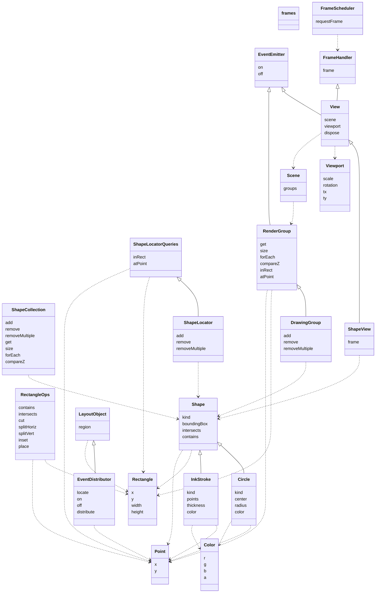

# Interface catalog

Generated by `npm run catalog` from `events.ts`, `geometry.ts`, `color.ts`, `shape.ts`, `frames.ts`, `view.ts`, `shapeView.ts`, `layout.ts`. Don't edit by hand. `catalog.html` is the interactive version.

Solid arrows with hollow heads are `extends`; dashed arrows are `uses` (a member or type parameter refers to the other interface).

## frames

`frames.ts`. Display frames. Each window is on one display, has that display's refresh, and has its own FrameScheduler.

| Rule | Tag | Headline | Status | Adversaries |
|---|---|---|---|---|
| `frames.complete` | ensures | Each input event updates the model completely before its handler returns, so nothing is left pending and no frame shows part of an action: running the frames afterward doesn't change the model. | tested | 1 |
| `frames.fraction-of-frame` | budget | A pen move or an eraser move updates the model in under 5% of a 120 Hz frame (about 0.42 ms), with 10,000 strokes in the document. | budget: not measured yet |  |

## EventEmitter

`events.ts`. Something that emits events. Each call to on adds one registration of a listener for one event, even if that listener is already registered.

| Rule | Tag | Headline | Status | Adversaries |
|---|---|---|---|---|
| `EventEmitter.order` | ensures | An emit calls its listeners in the order they were registered. | tested | 1 |
| `EventEmitter.snapshot` | ensures | An emit calls the listeners registered when it started: a listener added during the emit isn't called by it, and one removed during it still is. | tested | 1 |
| `EventEmitter.on.notified` | ensures | Each emit of the event calls the listener once for each of its registrations, synchronously, before the emit returns. | tested | 2 |
| `EventEmitter.off.removes-one` | ensures | Removes exactly one registration, the most recent, when there is one, and nothing otherwise. | tested | 4 |

## Point

`geometry.ts`. A location, in the coordinate space its use states.

No rules of its own.

## Rectangle

`geometry.ts`. An axis-aligned rectangle covering the half-open region [x, x + width) × [y, y + height). (x, y) is the top-left corner. The left and top edges are inside, and the right and bottom edges are not, so two rectangles that share only an edge do not overlap. A rectangle with width 0 or height 0 is empty and contains no points.

| Rule | Tag | Headline | Status | Adversaries |
|---|---|---|---|---|
| `Rectangle.non-negative-size` | valid | Width and height are never negative. | tested | 1 |

## RectangleOps

`geometry.ts`. Operations on rectangles, following Rectangle's half-open semantics. cut, splitHoriz, splitVert, inset and place are each defined exactly by their reference functions in geometry.vocab.ts.

| Rule | Tag | Headline | Status | Adversaries |
|---|---|---|---|---|
| `RectangleOps.no-mutation` | ensures | Never modifies its arguments. | tested |  |
| `RectangleOps.contains.half-open` | ensures | Left and top edges are inside; right and bottom edges are not. | tested |  |
| `RectangleOps.intersects.nonzero-area` | ensures | True only for overlap of nonzero area; shared edges, corners and empty rectangles don't count. | tested |  |
| `RectangleOps.intersects.symmetric` | ensures | The order of the arguments doesn't matter. | tested |  |
| `RectangleOps.cut.non-negative` | requires | size is at least 0. | caller's obligation |  |
| `RectangleOps.cut.exact` | ensures | Returns the strip and the rest as cutRect defines them. | tested | 2 |
| `RectangleOps.splitHoriz.weights` | requires | At least one weight, and every weight greater than 0. | caller's obligation |  |
| `RectangleOps.splitHoriz.exact` | ensures | Returns the rectangles splitRect defines: widths by largest remainder, side by side, tiling r. | tested | 3 |
| `RectangleOps.splitVert.weights` | requires | At least one weight, and every weight greater than 0. | caller's obligation |  |
| `RectangleOps.splitVert.exact` | ensures | Returns the rectangles splitRect defines: heights by largest remainder, stacked, tiling r. | tested | 1 |
| `RectangleOps.inset.non-negative` | requires | d is at least 0. | caller's obligation |  |
| `RectangleOps.inset.exact` | ensures | Returns the rectangle insetRect defines. | tested | 2 |
| `RectangleOps.place.non-negative` | requires | The size's width and height are at least 0. | caller's obligation |  |
| `RectangleOps.place.exact` | ensures | Returns the rectangle placeRect defines. | tested | 2 |

## Viewport

`geometry.ts`. A 2D similarity transform (uniform scale, rotation, translation) from canonical coordinates to view coordinates (see the top of this file).

| Rule | Tag | Headline | Status | Adversaries |
|---|---|---|---|---|
| `Viewport.positive-scale` | valid | Scale is greater than 0. | tested | 1 |

## Color

`color.ts`. An sRGB color with straight (not premultiplied) alpha.

| Rule | Tag | Headline | Status | Adversaries |
|---|---|---|---|---|
| `Color.rgb-range` | valid | r, g and b are integers from 0 to 255. | tested |  |
| `Color.alpha-range` | valid | a is from 0 (transparent) to 1 (opaque). | tested | 1 |

## Shape

`shape.ts`. A region of the plane, such as an ink stroke.

| Rule | Tag | Headline | Status | Adversaries |
|---|---|---|---|---|
| `Shape.immutable` | invariant | A shape's data fields, including nested ones, keep the values they had when it was made. | tested | 1 |
| `Shape.deterministic` | ensures | Every method returns the same result each time it is called with the same arguments. | tested |  |
| `Shape.boundingBox.exact` | abstract | The rectangle is exactly the shape's extents; each shape type states this for its own geometry. | abstract: refined by `InkStroke.box`, `Circle.box` |  |
| `Shape.intersects.empty-rect` | ensures | Never intersects an empty rectangle. | tested |  |
| `Shape.intersects.implies-box` | ensures | If the shape intersects r, so does its bounding box. | tested |  |
| `Shape.intersects.witness` | ensures | If some point is in both the shape and r, they intersect. | tested |  |
| `Shape.intersects.only-shared` | abstract | Intersects r only when some point is in both; each shape type states this for its own geometry. | abstract: refined by `InkStroke.exact-intersects`, `Circle.exact-intersects` |  |
| `Shape.contains.implies-box` | ensures | Every point in the shape is in its bounding box. | tested |  |

## InkStroke

`shape.ts`. A stroke of digital ink: a polyline drawn with a round pen. Consecutive duplicate points are allowed. Color does not affect geometry.

| Rule | Tag | Headline | Status | Adversaries |
|---|---|---|---|---|
| `InkStroke.has-points` | valid | Has at least one point; a single point draws a dot. | tested |  |
| `InkStroke.min-thickness` | valid | Thickness is at least 1. | tested |  |
| `InkStroke.box` | ensures | The bounding box is the points' extents, grown by half the thickness. | tested |  |
| `InkStroke.round-pen` | ensures | Covers every point within half the thickness of the polyline that lies in its bounding box as computed. | tested |  |
| `InkStroke.exact-intersects` | ensures | Intersects r exactly when some point it contains is in r; when the pen only touches r, contains() decides. | tested | 1 |

## Circle

`shape.ts`. A filled circle: the points within radius of center, with the half-open rule at its maximum x and y. It covers the same region as a one-point InkStroke with thickness 2 * radius, and its rules are those rules with [center] as the polyline.

| Rule | Tag | Headline | Status | Adversaries |
|---|---|---|---|---|
| `Circle.positive-radius` | valid | The radius is greater than 0. | tested |  |
| `Circle.box` | ensures | The bounding box is the center grown by the radius. | tested | 1 |
| `Circle.disk` | ensures | Covers every point within the radius of the center that lies in its bounding box as computed. | tested | 2 |
| `Circle.exact-intersects` | ensures | Intersects r exactly when some point it contains is in r; when the circle only touches r, contains() decides. | tested | 2 |

## ShapeCollection

`shape.ts`. A collection of shapes, kept in z-order.

| Rule | Tag | Headline | Status | Adversaries |
|---|---|---|---|---|
| `ShapeCollection.size` | invariant | size counts the shapes forEach visits. | tested | 1 |
| `ShapeCollection.z-order` | invariant | forEach visits each shape once, from bottom to top. | tested | 1 |
| `ShapeCollection.get-agrees` | invariant | get returns exactly the shapes forEach visits, under the same IDs. | tested | 1 |
| `ShapeCollection.observers-read-only` | ensures | get, size, forEach and compareZ never change the collection. | tested | 1 |
| `ShapeCollection.add.gettable` | ensures | The new ID retrieves the shape. | tested | 1 |
| `ShapeCollection.add.on-top` | ensures | The new shape is above every other shape. | tested | 1 |
| `ShapeCollection.add.fresh-id` | ensures | Never returns an ID it has returned before, even for a shape that was later removed. | tested | 2 |
| `ShapeCollection.add.others-kept` | ensures | Every other shape keeps its ID and its place in z-order. | tested | 1 |
| `ShapeCollection.remove.result` | ensures | Returns whether the shape was present. | tested | 1 |
| `ShapeCollection.remove.gone` | ensures | The shape is no longer retrievable. | tested | 1 |
| `ShapeCollection.remove.others-kept` | ensures | Every other shape keeps its ID and its place in z-order. | tested | 1 |
| `ShapeCollection.removeMultiple.count` | ensures | Returns the number of shapes actually removed. | tested | 1 |
| `ShapeCollection.removeMultiple.gone` | ensures | None of the listed shapes is retrievable. | tested | 1 |
| `ShapeCollection.removeMultiple.same-as-remove` | ensures | Has the same effect as calling remove() on each ID, in any order. | tested | 3 |
| `ShapeCollection.compareZ.present` | requires | Both shapes are in the collection. | caller's obligation |  |
| `ShapeCollection.compareZ.zero-iff-same` | ensures | Returns 0 only when comparing a shape with itself. | tested | 1 |
| `ShapeCollection.compareZ.antisymmetric` | ensures | Swapping the arguments flips the sign. | tested | 1 |

## ShapeLocatorQueries

`shape.ts`. Finds shapes by location. Read-only.

| Rule | Tag | Headline | Status | Adversaries |
|---|---|---|---|---|
| `ShapeLocatorQueries.no-retain` | ensures | Never keeps a reference to out after returning: later calls leave earlier out arrays unchanged. | tested | 1 |
| `ShapeLocatorQueries.read-only` | ensures | Queries never change what is indexed. | tested | 2 |
| `ShapeLocatorQueries.inRect.exact` | ensures | Reports exactly the indexed shapes that intersect r. | tested | 8 |
| `ShapeLocatorQueries.inRect.once` | ensures | Reports each ID at most once. | tested | 1 |
| `ShapeLocatorQueries.inRect.append` | ensures | Leaves what was already in out unchanged. | tested | 1 |
| `ShapeLocatorQueries.inRect.count` | ensures | Returns the number of IDs appended. | tested | 1 |
| `ShapeLocatorQueries.atPoint.exact` | ensures | Reports exactly the indexed shapes that contain p. | tested | 5 |
| `ShapeLocatorQueries.atPoint.once` | ensures | Reports each ID at most once. | tested | 1 |
| `ShapeLocatorQueries.atPoint.append` | ensures | Leaves what was already in out unchanged. | tested | 1 |
| `ShapeLocatorQueries.atPoint.count` | ensures | Returns the number of IDs appended. | tested | 1 |

## ShapeLocator

`shape.ts`. A spatial index that finds shapes by location, such as a quadtree. It holds IDs and geometry only.

| Rule | Tag | Headline | Status | Adversaries |
|---|---|---|---|---|
| `ShapeLocator.any-extent` | ensures | Accepts any shape that satisfies add's in-range rule; there is no fixed extent. | tested | 2 |
| `ShapeLocator.add.new-id` | requires | The ID is not already indexed. | caller's obligation |  |
| `ShapeLocator.add.in-range` | requires | The shape's bounding box lies within ±1e300, right and bottom edges included. | caller's obligation |  |
| `ShapeLocator.add.indexed` | ensures | Afterward, inRect finds the shape by its own bounding box, if the shape intersects that box. | tested |  |
| `ShapeLocator.remove.result` | ensures | Returns whether the ID was indexed. | tested | 2 |
| `ShapeLocator.remove.gone` | ensures | No query finds the ID afterward, until it is added again. | tested |  |
| `ShapeLocator.removeMultiple.count` | ensures | Returns the number of IDs actually removed. | tested | 1 |
| `ShapeLocator.removeMultiple.same-as-remove` | ensures | Has the same effect as calling remove() on each ID, in any order. | tested | 2 |

## FrameHandler

`frames.ts`. Something that does its work during a display frame.

No rules of its own.

## FrameScheduler

`frames.ts`. Calls handlers before the window's next display refresh. Implemented with requestAnimationFrame on the web, CADisplayLink on iOS and Choreographer on Android.

| Rule | Tag | Headline | Status | Adversaries |
|---|---|---|---|---|
| `FrameScheduler.requestFrame.merged` | ensures | Repeated requests with the same handler before a frame call its frame() once in that frame. | tested | 1 |
| `FrameScheduler.requestFrame.not-synchronous` | ensures | Never calls frame() before requestFrame returns. | tested | 1 |
| `FrameScheduler.requestFrame.next-frame` | ensures | A request made during a frame calls frame() in the following frame, not the current one. | tested | 1 |

## RenderGroup

`view.ts`. One group of a scene: items in z-order, found by location, emitting change when they change. A group presents some source of data, such as a ShapeCollection with a ShapeLocator, and is read-only: changes are made to the source, and the group shows them. regions(this) is the region of the plane each item covers, as the source defines it (see view.vocab.ts).

| Rule | Tag | Headline | Status | Adversaries |
|---|---|---|---|---|
| `RenderGroup.size` | invariant | size counts the items forEach visits. | tested | 1 |
| `RenderGroup.z-order` | invariant | forEach visits each item once, from bottom to top. | tested | 1 |
| `RenderGroup.get-agrees` | invariant | get returns exactly the items forEach visits, under the same IDs. | tested | 1 |
| `RenderGroup.stable` | ensures | While an ID is present, get returns the same item for it. | tested | 1 |
| `RenderGroup.no-reuse` | ensures | An ID that has gone never comes back. | tested | 2 |
| `RenderGroup.read-only` | ensures | Reading, querying, on and off never change the items. | tested | 2 |
| `RenderGroup.no-retain` | ensures | Never keeps a reference to a query's out array after returning: later calls leave earlier out arrays unchanged. | tested | 1 |
| `RenderGroup.notifies` | ensures | After a change to the source that changes the items, emits change once before the change returns, when every observer and query already shows the new items. | tested | 8 |
| `RenderGroup.quiet` | ensures | Emits change only as notifies says. | tested | 4 |
| `RenderGroup.compareZ.present` | requires | Both items are in the group. | caller's obligation |  |
| `RenderGroup.compareZ.zero-iff-same` | ensures | Returns 0 only when comparing an item with itself. | tested | 1 |
| `RenderGroup.compareZ.antisymmetric` | ensures | Swapping the arguments flips the sign. | tested | 1 |
| `RenderGroup.inRect.exact` | ensures | Reports exactly the items whose regions intersect r. | tested | 1 |
| `RenderGroup.inRect.once` | ensures | Reports each ID at most once. | tested | 1 |
| `RenderGroup.inRect.append` | ensures | Leaves what was already in out unchanged. | tested | 1 |
| `RenderGroup.inRect.count` | ensures | Returns the number of IDs appended. | tested | 1 |
| `RenderGroup.atPoint.exact` | ensures | Reports exactly the items whose regions contain p. | tested | 1 |
| `RenderGroup.atPoint.once` | ensures | Reports each ID at most once. | tested | 1 |
| `RenderGroup.atPoint.append` | ensures | Leaves what was already in out unchanged. | tested | 1 |
| `RenderGroup.atPoint.count` | ensures | Returns the number of IDs appended. | tested | 1 |

## Scene

`view.ts`. What views draw: groups in canonical coordinates, the same for every view, with no viewport. groups[0] is the bottom group. Groups are drawn bottom to top, and each group's items in that group's z-order. A scene is only a list of groups, so scenes can share groups.

No rules of its own.

## View

`view.ts`. Shows a scene on screen through a viewport, and stays current. A view for a particular data model, such as ShapeView, draws its items for its platform's surface.

| Rule | Tag | Headline | Status | Adversaries |
|---|---|---|---|---|
| `View.group-change` | ensures | When a group changes, requests a frame and draws nothing until frame(). | tested | 2 |
| `View.idle` | ensures | Requests no frame while nothing it shows changes. | tested | 1 |
| `View.one-listener` | ensures | Until disposed, has exactly one listener registered on each group of its scene. | tested | 2 |
| `View.read-only` | ensures | Reading scene or viewport changes nothing: what it shows, its frame requests and its listeners stay as they were. | tested | 1 |
| `View.viewport.set-redraws` | deferred | Setting a different viewport requests a frame, and that frame draws through the new viewport. | deferred: when a ShapeView supports viewports other than the identity. |  |
| `View.viewport.set-equal` | ensures | Setting a viewport equal to the current one, field by field, requests no frame and emits nothing. | tested | 1 |
| `View.viewport.set-emits` | deferred | Setting a different viewport emits viewport with the new value before the setter returns. | deferred: when a ShapeView supports viewports other than the identity. |  |
| `View.dispose.detaches` | ensures | Afterward, the view has no listeners on the scene's groups, and group changes request no frame. | tested | 1 |
| `View.dispose.inert` | ensures | Afterward, frame() draws nothing, including a frame requested before dispose. | tested | 1 |

## ShapeView

`shapeView.ts`. A view of shapes. It draws each kind of shape itself, on its platform's surface; for now the only kind is Circle. painted(this, p) (shapeView.vocab.ts) is what the view shows at point p.

| Rule | Tag | Headline | Status | Adversaries |
|---|---|---|---|---|
| `ShapeView.fixed-groups` | requires | The scene's list of groups doesn't change while the view exists; the items in each group may. The view starts listening to each group when it is created. | caller's obligation |  |
| `ShapeView.circles-only` | requires | Every item in the scene is a Circle; other kinds are outside the rules until their drawing is specified. | caller's obligation |  |
| `ShapeView.first-frame` | ensures | Requests a frame when created, so that its first frame shows the scene. | tested | 1 |
| `ShapeView.frame.paints` | ensures | Afterward, each point of the surface that is on no circle's edge shows the circles containing it, composited bottom to top. | tested | 5 |

## DrawingGroup

`shapeView.ts`. A group of shapes with edits. Each item is its own shape and its own region.

| Rule | Tag | Headline | Status | Adversaries |
|---|---|---|---|---|
| `DrawingGroup.add.on-top` | ensures | The shape becomes the top item, under the returned ID, which wasn't present before; the other items stay, in the same order. | tested | 1 |
| `DrawingGroup.remove.result` | ensures | Returns whether the item was present; afterward it isn't, and the other items stay, in the same order. | tested | 1 |
| `DrawingGroup.removeMultiple.result` | ensures | Returns the number of items removed; the other items stay, in the same order. | tested | 1 |

## LayoutObject

`layout.ts`. Something placed in a region of a window.

No rules of its own.

## EventDistributor

`layout.ts`. Passes a platform's positional events to listeners by where they fall. M is the platform's event map, limited to the positional events it distributes.

| Rule | Tag | Headline | Status | Adversaries |
|---|---|---|---|---|
| `EventDistributor.within` | requires | Each registered target's region lies within this distributor's region. | caller's obligation |  |
| `EventDistributor.nested-or-disjoint` | requires | For each event name, the regions of two different targets registered for it are disjoint, or one lies strictly within the other. | caller's obligation |  |
| `EventDistributor.live-regions` | ensures | distribute uses each target's region as it is when it is called. | tested | 1 |
| `EventDistributor.snapshot` | ensures | distribute calls the registrations that existed when it started: one added during the call isn't called by it, and one removed during it still is. | tested | 1 |
| `EventDistributor.on.registers` | ensures | Adds one registration, even if the same one exists already. | tested | 1 |
| `EventDistributor.off.removes-one` | ensures | Removes exactly one registration, the most recent with the same event name, listener and target, when there is one, and nothing otherwise. | tested | 3 |
| `EventDistributor.distribute.innermost` | ensures | Delivers to the innermost target registered for eventName, other than except, whose region contains locate(event), and to no other target. | tested | 7 |
| `EventDistributor.distribute.only-enclosed` | ensures | When no such target exists, calls no listener. | tested | 1 |
| `EventDistributor.distribute.reports` | ensures | Returns true when it delivered to a target, and false otherwise. | tested | 1 |
| `EventDistributor.distribute.detached` | ensures | Behaves the same when called as a plain function, as a listener is, rather than as a method of the distributor. | tested | 1 |
